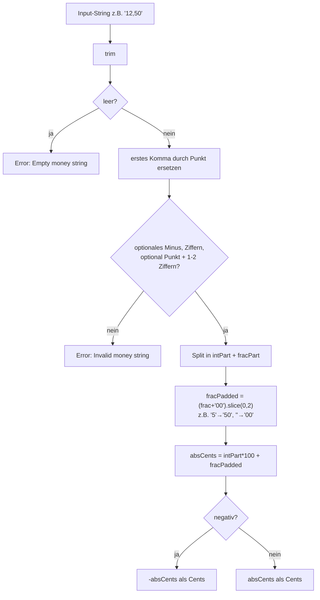

# Geld-Darstellung: Cents-System

**Quelle:** `packages/shared/src/money.ts`

Die verbindliche Regel steht in [00-grundregeln.md](./00-grundregeln.md) §5; diese Seite beschreibt
die Werkzeuge dazu.

## Warum Cents?

JavaScript-Floating-Point: `0.1 + 0.2 === 0.30000000000000004`

Deshalb werden alle Geldbeträge als **ganze Zahlen in Cent** gespeichert und transportiert.

```
12,50 € → amountCents = 1250
-5,00 € → amountCents = -500
```

## Branded Type

```typescript
type Cents = number & { readonly __brand: "Cents" };
```

- Nur im Typsystem — zur Laufzeit eine normale `number`
- Verhindert, dass rohe `number`-Werte versehentlich als `Cents` übergeben werden

## Konvertierungsfunktionen

| Funktion | Input | Output | Zweck |
|---|---|---|---|
| `parseCents(str)` | `"12.50"`, `"12,50"`, `"-5"` | `Cents`, wirft bei ungültiger Eingabe | Betragsfelder der Formulare (Buchung, Dauerauftrag, Sparziel, Entnahme, Einrichtungs-Assistent) |
| `parseMoneyInput(str)` | `"1.234,56"`, `"12.5"` | `number` (Cents) oder `null` | Budget-Editor (`components/budgets/BudgetPlanEditor.tsx`): deutsch oder englisch getippte Beträge mit Tausendertrennern, keine negativen Werte |
| `fromCents(n)` | `1250` (DB-Integer) | `Cents` | Datenbank-Wert branden |
| `toDecimalString(c)` | `Cents` | `"12.50"` | Anzeige (ohne Währung) |
| `formatEuro(c, locale)` | `Cents`, `"de"` oder `"en"` | `"1.234,56 €"` bzw. `"€1,234.56"` | Lokalisierte Anzeige mit Währung; nur vom Steuer-PDF genutzt |

### Die beiden Parser sind nicht gleich

`parseCents` und `parseMoneyInput` lesen dieselbe Eingabe teilweise unterschiedlich. Geprüft gegen
den Code:

| Eingabe | `parseCents` | `parseMoneyInput` |
|---|---|---|
| `12,50` / `12.50` / `12.5` | 1250 | 1250 |
| `-5` | -500 | `null` (kein Vorzeichen erlaubt) |
| `1.234` | Fehler (drei Nachkommastellen) | 123400 (Punkt = Tausendertrenner) |
| `1.234,56` | Fehler | 123456 |
| `1,234` | Fehler | `null` |
| `0.500` | Fehler | `null` |
| leer | Fehler | `null` |

Ein Betragsfeld der Formulare lehnt `1.234` also ab, der Budget-Editor liest es als 1.234,00 €.

## Arithmetik

```typescript
add(a, b)        // a + b, immer Integer
sub(a, b)        // a - b, kann negativ sein
multiply(a, f)   // Math.round(a * f), z.B. für Prozentrechnungen
```

Aus `@doewe/shared` werden die drei Funktionen als `addCents`, `subCents` und `multiplyCents`
exportiert.

Auch wo eine Funktion Euro-Werte entgegennimmt, wird in Cents gerechnet:
`computeAvailableBudget` (`packages/shared/src/dashboardBudget.ts`) bekommt die Euro-Felder der
Summary-Antwort, rundet jeden Eingang auf ganze Cents, rechnet und vergleicht in Cents und teilt erst
die Ergebnisse wieder durch 100. Mit Euro-Floats ergab `399,20 − 299,22 − 99,98` den Wert `-5.7e-14`
statt 0.

## Parse-Logik (`parseCents`)



Die Regeln von `parseMoneyInput` (Komma = Dezimaltrenner, Punkte als Tausendertrenner, genau ein
Punkt mit drei Ziffern danach = Tausendertrenner) stehen im Kommentar über der Funktion in
`money.ts`.

## Ausgabe-Konvention

- Gerechnet wird in den Route-Handlern durchgehend in Cents.
- **Cents (Integer)** liefern die CRUD-Endpunkte (`/api/transactions`, `/api/recurring-transactions`,
  `/api/budgets`, `/api/budget-plans`, `/api/saving-plan`) und die Auswertungen
  `/api/analytics/quarterly`, `/api/analytics/monthly-review`, `/api/analytics/category-year`,
  `/api/recurring-transactions/yearly` und `/api/tax`. Die Felder heißen `amountCents` oder enden
  auf `Cents`.
- **Euro (Dezimalzahl)** liefert nur `GET /api/analytics/summary`: dort wird am Ende des Handlers
  durch 100 geteilt. Ausnahme innerhalb dieser Antwort: `recurringTransactions[].amountCents` bleibt
  ein Integer in Cents.
- Der CSV-Export der Daueraufträge (`/api/recurring-transactions/export`) schreibt Beträge als Text
  mit Dezimalkomma (`12,34`).

## Vorzeichen-Konvention

| Wert | Bedeutung |
|---|---|
| `amountCents > 0` | Geld kommt auf das Konto (z.B. Gehalt) |
| `amountCents < 0` | Geld verlässt das Konto (z.B. Miete) |
| `amountCents = 0` | zählt als Einnahme, damit jede Buchung genau eine Klasse hat |

Das Vorzeichen gilt einheitlich in `Transaction` und `RecurringTransaction`. Ob eine Buchung
Einnahme, Ausgabe oder Sparen ist, entscheidet aber nicht das Vorzeichen allein: eine Buchung in
einer Spar-Kategorie ist immer Sparen (Einzahlung negativ, Entnahme positiv). Die Regel steht in
[00-grundregeln.md](./00-grundregeln.md) §2.
