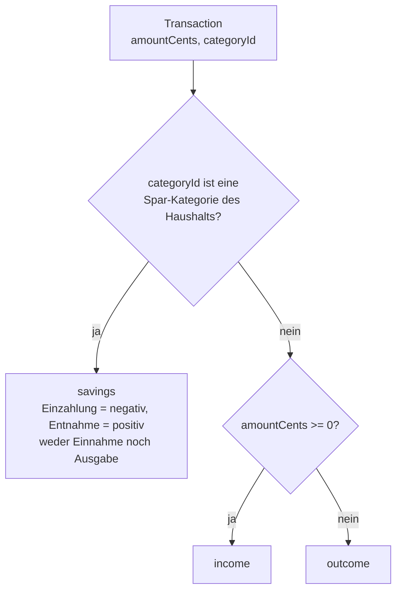

# Transaktionen — Klassifizierung und Verhalten

**Quellen:**
- `packages/shared/src/cashflow.ts` (Einordnung: `classifyFlow`, `sumFlows`, `isSavingsCategoryName`)
- `packages/shared/src/transactionFilter.ts` (Filter und Summen der Buchungsliste)
- `apps/web/lib/savingsCategory.ts` (`loadSavingsCategoryIds`)
- `apps/web/app/api/transactions/route.ts`, `schema.ts`, `[id]/route.ts`
- `apps/web/app/api/transactions/batch/route.ts`, `batch/schema.ts` (Buchungen aus einem Beleg-Scan)

Die Regeln für Kalender, Einordnung und Umfang stehen in [00-grundregeln.md](./00-grundregeln.md).
Diese Seite zeigt, wo sie im Code liegen und was die Transaktions-Endpunkte annehmen.

## Transaktion-Typen

Eine Transaktion hat keinen expliziten "Typ"-Enum. Die Einordnung macht `classifyFlow` aus der
Kategorie und dem Vorzeichen von `amountCents` — in dieser Reihenfolge (Grundregeln §2):



`sumFlows` bildet daraus vier Summen (`FlowTotals`):

| Feld | Inhalt |
|---|---|
| `incomeCents` | Summe der Einnahmen, `>= 0` |
| `outcomeCents` | Summe der Ausgaben als positiver Betrag, `>= 0` |
| `savingsCents` | Sparen netto: Einzahlungen minus Entnahmen, kann negativ sein |
| `netCents` | `incomeCents − outcomeCents − savingsCents` = Summe aller `amountCents` |

Alle Routen, die Buchungen summieren (Dashboard, Rückblick, Quartalsübersicht, Jahresübersicht nach
Kategorien, Budget-Warnung), rufen diese Funktionen auf; keine entscheidet selbst.

## Spar-Kategorie-Erkennung

Die Spar-Kategorie wird **nicht per Flag in der DB** markiert, sondern über den **Namen** erkannt.
Für die Einordnung gilt die Definition in `cashflow.ts`:

```typescript
export const SAVINGS_CATEGORY_NAMES: readonly string[] = ["savings", "sparen"];

export function isSavingsCategoryName(name: string): boolean {
  return SAVINGS_CATEGORY_NAMES.includes(name.trim().toLowerCase());
}
```

- Schreibung egal: "Savings", "SPAREN", " sparen " — alle werden erkannt
- Nur die beiden Wörter `savings` und `sparen` werden erkannt — nichts anderes
- Ein Haushalt kann **mehrere** Spar-Kategorien haben (z.B. "Savings" und "Sparen"); dann zählen
  alle. `loadSavingsCategoryIds(householdId)` liefert die Ids aller Spar-Kategorien des Haushalts,
  und jede Route löst sie über diese eine Funktion auf.
- Wenn keine solche Kategorie existiert, gibt es keine Sparbuchungen; dann entscheidet überall das
  Vorzeichen.

## Sparbuchung-Konvention

Eine Buchung in einer Spar-Kategorie ist Sparen: Geld verlässt den Monat oder kommt aus dem Ersparten
zurück. Einen Spar-Bestand führt Doewe nicht ([07-sparziele.md](./07-sparziele.md)):

```
Einzahlung: amountCents = -20000  (Geld verlässt das Girokonto)   → savingsCents += 20000
Entnahme:   amountCents = +5000   (Geld kommt zurück)             → savingsCents -= 5000
```

Eine Entnahme ist **keine Einnahme** und eine Einzahlung **keine Ausgabe**. Entnahmen entstehen über
`POST /api/saving-plan/withdraw` (siehe [07-sparziele.md](./07-sparziele.md)) oder als von Hand
angelegte positive Buchung in einer Spar-Kategorie.

Folgen der Vorzeichen-Regel außerhalb der Spar-Kategorien (Grundregeln §2): Eine Erstattung
(positiver Betrag in einer Ausgaben-Kategorie) ist eine Einnahme und verringert die Ausgaben der
Kategorie nicht; eine negative Buchung in einer Einnahmen-Kategorie ist eine Ausgabe.

## savingGoalId — Verknüpfung mit Sparzielen

Transaktionen können optional mit einem `Budget`-Eintrag (Sparziel) verknüpft werden:

```typescript
savingGoalId?: string  // Optional, zeigt auf Budget.id
```

Diese Verknüpfung wird im `saving-plan`-Endpoint ausgewertet:

```typescript
// saving-plan/route.ts
transactions: { where: { deletedAt: null }, select: { amountCents: true, categoryId: true } }
// …
transactionSpentCents: linkedSpentCents(goal.transactions, savingsIds)   // compute.ts
```

- Summiert werden die verknüpften, **nicht gelöschten** Buchungen. Der Soft-Delete-Filter aus
  `lib/prisma.ts` greift nur im obersten `where`; deshalb schließt die Abfrage gelöschte Buchungen
  im verschachtelten `include` selbst aus (Grundregeln §3).
- Eingeordnet wird mit `classifyFlow`: Ausgaben minus Erstattungen, mindestens 0; Buchungen einer
  Spar-Kategorie zählen nicht.
- Die Oberfläche zeigt den Wert als für das Ziel **aus dem Monatsbudget ausgegeben** an. Was direkt vom
  Sparkonto bezahlt wurde, steht als Zahlung aus dem Ersparten am Ziel, nicht als Buchung (siehe
  [07-sparziele.md](./07-sparziele.md)).

## API: POST /api/transactions

Mandant ist der Haushalt: Konto, Kategorie und Sparziel müssen zum Haushalt des eingeloggten Nutzers
gehören, sonst `404`.

**Body** (`TransactionInput` in `schema.ts`):

| Feld | Regel |
|---|---|
| `id` | optional, cuid2 — vom Client vergebene Id für die Offline-Erfassung; schon vergeben → `409` |
| `accountId` | Pflicht |
| `categoryId` | optional (weglassen, nicht `null`) |
| `savingGoalId` | optional, Id einer `Budget`-Zeile des Haushalts |
| `amountCents` | ganze Zahl im Bereich der Postgres-Spalte `Int` (−2.147.483.648 … 2.147.483.647) |
| `description` | Pflicht; Leerraum am Rand wird entfernt, danach nicht leer; kein NUL-Zeichen, kein halbes Surrogat-Paar |
| `occurredAt` | ISO-Zeitpunkt **oder** reiner Kalendertag `yyyy-mm-dd` (siehe unten) |
| `taxRelevant` | optional; fehlt es, erbt die Buchung `isTaxRelevant` ihrer Kategorie, sonst `false` |

**Kein automatisches Buchungsdatum** — `occurredAt` wird immer explizit übergeben.

**Idempotenz:** Mit dem Header `Idempotency-Key` (von der Offline-Outbox gesetzt) wird die Antwort
zusammen mit der Buchung im `MutationLog` gespeichert; eine Wiederholung mit demselben Schlüssel
bekommt die gespeicherte Antwort zurück und bucht nicht doppelt.

**Fehler sind `400`, nicht `500`:** Kein gültiges JSON, eine Beschreibung nur aus Leerraum, ein
Betrag außerhalb von int4, ein unlesbares Datum oder eines außerhalb der Jahre 1900–9999 werden von
der Validierung abgewiesen. Hintergrund: Die Offline-Outbox hält bei jedem 5xx an, um ihre
Reihenfolge zu wahren — eine einzige solche Eingabe hätte alle späteren Offline-Buchungen blockiert.

Nach dem Anlegen prüft die Route die Budget-Warnung der Kategorie (siehe
[06-budgets.md](./06-budgets.md)).

### PATCH und DELETE /api/transactions/[id]

- `PATCH` validiert gegen dasselbe Schema wie `POST` (voller Body, kein Teil-Update) und liest
  `occurredAt` mit demselben Parser. Geändert werden Konto, Kategorie, Betrag, Beschreibung, Datum
  und `taxRelevant` (fehlt das Feld, bleibt der gespeicherte Wert). `savingGoalId` wird von `PATCH`
  nicht geändert.
- `DELETE` löscht weich: Die Buchung bekommt `deletedAt` (Tombstone), ihre Belege werden in derselben
  Datenbank-Transaktion entfernt. Gelöschte Buchungen zählen in keiner Auswertung (Grundregeln §3).
  Eine gelöschte Buchung eines Dauerauftrags belegt ihre Periode weiterhin — der Monat wird nicht
  erneut gebucht (siehe [03-wiederkehrende-transaktionen.md](./03-wiederkehrende-transaktionen.md)).

### POST /api/transactions/batch (Beleg-Scan)

Legt aus einem gescannten Beleg je Kategorie-Gruppe eine Buchung mit ihren Einzelpositionen
(`ReceiptLineItem`) an, alles in einer Datenbank-Transaktion.

- **Betrag = negierte Gruppensumme**, mit Vorzeichen: `amountCents = −Σ totalCents` der Gruppe. Eine
  positive Gruppensumme ist eine Ausgabe; eine negative (Rabatt, Gutschein oder Pfandrückgabe, die
  allein in einer Kategorie steht) wird als positive Buchung angelegt. Die Buchungen eines Belegs
  ergeben so zusammen immer minus die Belegsumme. Beispiel: Lebensmittel 10,00 € und ein Gutschein
  von −2,00 € in einer anderen Kategorie ergeben −10,00 € und +2,00 €, zusammen −8,00 €.
- Gruppen mit Summe 0 werden übersprungen; bleibt nichts zu buchen, antwortet die Route mit `400`.
- `receiptDate` ist ein Kalendertag `yyyy-mm-dd` und wird als 12:00 Uhr Berliner Zeit gespeichert.
- `taxRelevant` ist optional; fehlt es, erbt jede Buchung `isTaxRelevant` ihrer Kategorie.
- Cent-Beträge und die Gruppensumme müssen in int4 passen; Validierungsfehler kommen als `400` mit
  einem Text, der das Feld nennt.

## Zeitberechnung

`occurredAt` ist ein Zeitpunkt (in der Datenbank UTC). Zu welchem Tag, Monat und Jahr eine Buchung
gehört, bestimmt ihr Kalendertag **in Europe/Berlin** — auf dem Server wie im Browser (Grundregeln
§1).

`parseOccurredAt` in `apps/web/app/api/transactions/schema.ts` liest das Datum für `POST` und
`PATCH`:

- Ein reiner Kalendertag (`yyyy-mm-dd`) wird als **12:00 Uhr Berliner Zeit** dieses Tages
  gespeichert. Ein Tag, den es nicht gibt (z.B. `2026-02-30`), ist ungültig.
- Ein ISO-Zeitpunkt mit Zeitzone (`2026-11-19T10:00:00.000Z`, `…+01:00`) wird unverändert
  gespeichert. Fehlt die Zeitzone (`2026-11-19T11:00:00`), gilt er als Berliner Uhrzeit.
- Alles andere — kein ISO-Format, ein Datum, das es nicht gibt, ein Jahr vor 1900 (Tippfehler wie
  `0026`) oder nach 9999 — → `400`.

## Buchungsliste: Filter und Summen

`GET /api/transactions` liefert alle nicht gelöschten Buchungen aller Konten des Haushalts,
absteigend nach `occurredAt`, ohne Query-Parameter. Gefiltert und summiert wird im Browser — nach
Regeln, die in `packages/shared/src/transactionFilter.ts` festgelegt sind, damit die Liste jede Zahl
der Auswertungen aus denselben Zeilen reproduzieren kann (Grundregeln §6):

| Funktion | Regel |
|---|---|
| `filterTransactions(rows, filter, savingsIds)` | Typ-Filter (`all`, `income`, `outcome`, `savings`) über `classifyFlow`; Kategorie-Filter auf die exakte `categoryId`; Zeitraum `fromDay`/`toDay` als Kalendertage in Europe/Berlin, der letzte Tag zählt ganz. Ein nicht lesbares Datum gilt als "keine Grenze". |
| `listTotals(rows, savingsIds)` | Anzahl plus dieselben vier Summen wie `sumFlows` |
| `monthDayRange(ref)` | `fromDay`/`toDay`, die genau einen Kalendermonat umfassen |
| `monthOfDayRange(fromDay, toDay)` | der Monat, den ein Zeitraum genau umfasst, sonst `null` |
| `monthsWithTransactions(rows)` | die Berliner Kalendermonate mit mindestens einer Buchung, neueste zuerst |

Filtert man die Liste auf einen Monat und den Typ "Ausgaben", ist die Summe die Ausgaben-Zahl des
Rückblicks für diesen Monat. `apps/web/tests/reconciliation.test.ts` prüft das gegen die Antworten
der API.

### CSV-Export der Liste

„Als CSV exportieren“ in der Summenzeile über der Liste lädt genau die angezeigten Buchungen herunter:
mit allen Filtern, der Textsuche und der gewählten Sortierung. Die Datei entsteht im Browser aus den
geladenen Zeilen (`buildTransactionsCsv` in `packages/shared/src/transactionExport.ts`), funktioniert
also auch offline und braucht keinen eigenen Endpunkt.

| Spalte | Inhalt |
|---|---|
| Datum | Kalendertag in Europe/Berlin als `yyyy-mm-dd` (`zonedDayKey`), derselbe Tag wie in Liste und Filter |
| Beschreibung, Kategorie | Freitext; leer ohne oder mit unbekannter Kategorie |
| Typ | Einnahme, Ausgabe oder Sparen über `classifyFlow` — dieselbe Einordnung wie die Summenzeile |
| Betrag | gespeichertes Vorzeichen, also negativ für Geld, das das Konto verlässt — wie auf dem Kontoauszug |
| Dauerauftrag, Steuerrelevant | ja/nein |

Format wie beim Export der Daueraufträge: Trennzeichen `;`, Dezimalkomma ohne Tausenderpunkt, CRLF,
UTF-8 mit BOM; Freitext, der mit `=`, `+`, `-` oder `@` beginnt, bekommt ein führendes `'`, damit eine
Tabellenkalkulation ihn nicht als Formel ausführt. Spaltenköpfe und Typnamen folgen der Sprache der
Oberfläche. Dateiname: `buchungen-2026-11.csv` für genau einen Kalendermonat,
`buchungen-2026-11-01_2026-11-22.csv` für einen anderen Zeitraum, sonst `buchungen.csv` (englisch:
`transactions…`).
