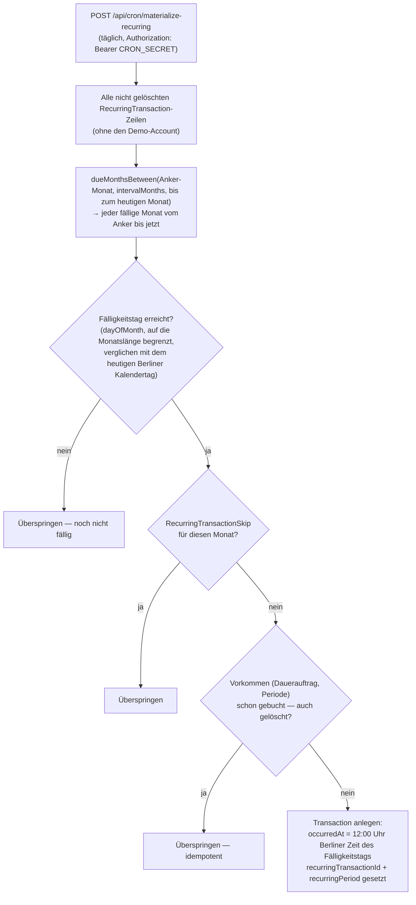
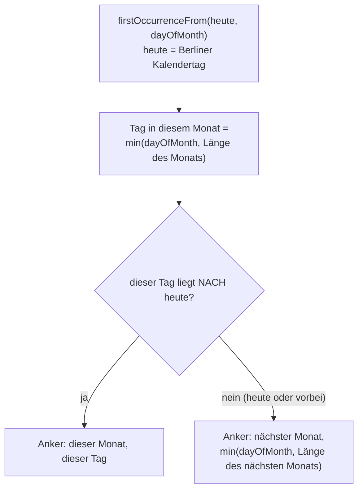
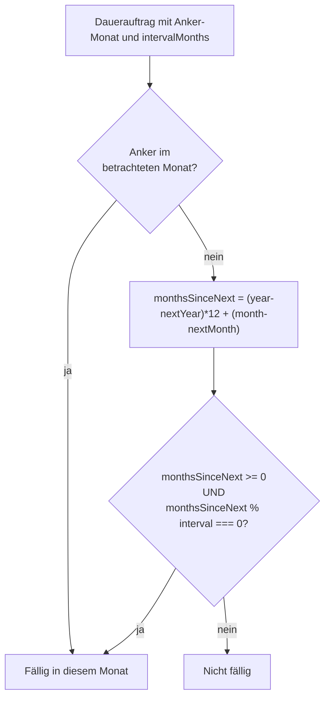

# Wiederkehrende Transaktionen (Daueraufträge)

**Quellen:**
- `apps/web/app/api/recurring-transactions/route.ts`
- `apps/web/app/api/recurring-transactions/[id]/route.ts`
- `apps/web/app/api/recurring-transactions/skips/route.ts`
- `apps/web/app/api/recurring-transactions/yearly/route.ts`, `export/route.ts`
- `apps/web/app/api/transactions/[id]/make-recurring/route.ts` (Buchung → Dauerauftrag)
- `packages/shared/src/recurringSchedule.ts` (Fälligkeit, Anker, Tag im Monat)
- `packages/shared/src/recurringYear.ts`, `recurringExport.ts`, `apps/web/lib/recurringYear.ts` (Jahresmatrix, CSV)
- `apps/web/lib/recurringBooking.ts` (automatisches Buchen)
- `apps/web/lib/recurringPeriods.ts` (welche Vorkommen als gebucht gelten)
- `apps/web/app/api/cron/materialize-recurring/route.ts` (täglicher Cron-Trigger)

Kalender, Einordnung und die Begriffe „gebucht" und „geplant" sind in
[00-grundregeln.md](./00-grundregeln.md) §1, §2 und §4 festgelegt. Alle Kalenderwerte auf dieser
Seite — Anker-Monat, „heute", Fälligkeitstag, Periode — sind Werte in **Europe/Berlin**, unabhängig
von der Zeitzone des Servers.

## Was sind Daueraufträge?

Daueraufträge sind **Vorlagen** für regelmäßige Buchungen (z.B. Miete, Gehalt, Abonnements).

Fällige Vorkommen werden **automatisch als echte `Transaction`-Zeile gebucht**, sobald ihr Tag
erreicht ist: täglich durch den Cron `materialize-recurring` und, für abgeschlossene Monate, beim
Lesen der Auswertungen. Nur ein im laufenden Monat fälliges, noch nicht gebuchtes Vorkommen gilt als
„geplant" und fließt in die Hochrechnung des Dashboards ein (siehe unten).

## Vorkommen: Dauerauftrag + Periode

Ein Vorkommen ist das Paar `(recurringTransactionId, recurringPeriod)`. Die Periode ist der Monat
(`JJJJ-MM`), **für den** gebucht wurde; sie steht als `Transaction.recurringPeriod` auf der Buchung.

- Ein Monat gilt als gebucht, sobald eine Buchung mit dieser `recurringTransactionId` und dieser
  Periode existiert — **auch eine gelöschte** (Tombstone).
- Der Monat von `occurredAt` spielt dafür keine Rolle. Wer die Buchung in einen anderen Monat
  verschiebt oder sie löscht, macht den Monat nicht wieder „offen": er wird nicht erneut gebucht und
  im Dashboard nicht wieder als geplant gezeigt. Eine in den Folgemonat verschobene Buchung
  verdrängt umgekehrt nicht das eigene Vorkommen des Folgemonats.
- Buchungen aus der Zeit vor der Spalte `recurringPeriod` (Wert `null`) zählen für den Berliner Monat
  ihres `occurredAt` (`periodOfBooking` in `lib/recurringPeriods.ts`). Die Migration
  `20261119120000_add_recurring_period` hat bestehende Zeilen nach derselben Regel befüllt.

`loadBookedOccurrenceKeys(recurringIds)` liefert die Schlüssel `"<recurringId>:<JJJJ-MM>"` aller
gebuchten Vorkommen. Dieselbe Funktion beantwortet „schon gebucht?" beim automatischen Buchen, im
Dashboard und in der Budget-Warnung.

## Automatisches Buchen (`materializeDueRecurringTransactions`)



- **Fälligkeit nach Kalendertagen:** Verglichen werden Kalendertage, nicht Zeitpunkte
  (`isOnOrBeforeDate`). Ein Vorkommen ist ab 00:00 Uhr Berliner Zeit seines Tages fällig, auch wenn
  es auf 12:00 Uhr datiert wird.
- **Tag im Monat:** `occurrenceDate` begrenzt `dayOfMonth` auf die Monatslänge (31 → 30 im November,
  28/29 im Februar).
- **Demo-Account:** Daueraufträge des öffentlichen Demo-Kontos (`DEMO_ACCOUNT_ID`) werden nie
  automatisch gebucht.
- **Felder der Buchung:** Konto, Kategorie, Betrag und Beschreibung des Dauerauftrags;
  `taxRelevant` erbt die Steuer-Markierung der Kategorie (wie eine von Hand angelegte Buchung; eine
  gelöschte Kategorie gibt nichts weiter).
- **`?dryRun=true`** schreibt nichts und listet nur, was gebucht würde. Antwort in beiden Fällen:
  `{ ok, dryRun, booked, occurrences }`.

**Dieselbe Funktion holt den Tagesbetrieb und die Vergangenheit nach:** `dueMonthsBetween` listet
jeden fälligen Monat vom Anker (`nextOccurrence`) bis heute. Ein Dauerauftrag, der seit Monaten nie
gebucht wurde, bekommt beim ersten Lauf alle fehlenden Monate auf einmal nachgebucht — mit dem
**aktuell hinterlegten Betrag** (kein historischer Betrags-Snapshot). Hat sich ein Betrag
zwischenzeitlich geändert (z.B. Nebenkosten-Abschlag), werden vergangene Monate mit dem aktuellen
Betrag befüllt; die betroffene Buchung muss dann von Hand korrigiert werden.

**Selbstheilung beim Lesen (`catchUpPastRecurringForHousehold`):** `GET /api/analytics/summary`,
`/api/analytics/monthly-review`, `/api/analytics/quarterly` und `/api/analytics/category-year` buchen
vor jeder Berechnung alle fälligen, noch nicht gebuchten Vorkommen **abgeschlossener Monate** des
eigenen Haushalts nach (dieselbe Funktion, auf den Haushalt und bis zum letzten Tag des Vormonats
begrenzt). Diese GET-Anfragen können also schreiben. Der laufende Monat bleibt Aufgabe des Crons und
erscheint bis dahin als „geplant". Hintergrund: Der Cron war in Produktion nie eingerichtet, dadurch
fehlten ab Oktober 2026 alle Daueraufträge im Rückblick und im Übertrag, ohne dass es sichtbar wurde.

**Nebenläufigkeit:** Cron und Selbstheilung (z.B. zwei Haushaltsmitglieder öffnen gleichzeitig das
Dashboard) können parallel laufen. Gebuchte Vorkommen und Skips werden vorab gesammelt geladen; für
jedes fehlende Vorkommen wird je Dauerauftrag ein transaktionsgebundener Advisory-Lock
(`pg_advisory_xact_lock`) genommen und unter dem Lock dieselbe Vorkommens-Identität erneut geprüft,
sodass jeder Monat höchstens einmal gebucht wird. Schlägt ein einzelnes Vorkommen fehl, wird es
geloggt und der Lauf läuft für alle anderen weiter.

**Doppelzählung vermieden:** Sobald ein Vorkommen gebucht ist, zählt es nicht mehr als „geplant" in
`recurringIncomeTotal`/`recurringOutcomeTotal`/`recurringPlannedSavings` (siehe
[04-analytics-summary.md](./04-analytics-summary.md)).

### Bekannte Grenzen

- **Von Hand erfasste Zahlung:** Eine Buchung, die von Hand angelegt wurde, hat keine
  `recurringTransactionId` und wird nicht als Vorkommen eines Dauerauftrags erkannt. Wer eine Zahlung
  von Hand bucht und zusätzlich einen Dauerauftrag dafür hat, bekommt sie doppelt. Abhilfe: den Monat
  überspringen (Skip), bevor er gebucht ist, oder die doppelte Buchung löschen. Vor einem Nachbuchen
  auf echten Daten zeigt `?dryRun=true`, was gebucht würde. Nur beim Anlegen ohne Startdatum am
  Fälligkeitstag selbst ist der Fall abgefangen (siehe „Der Anker").
- **Startdatum in der Vergangenheit:** Ein Anker in der Vergangenheit lässt jeden fälligen Monat seit
  dem Anker nachbuchen — beim nächsten Cron-Lauf bzw. beim nächsten Öffnen einer Auswertung.
- **Kein Betrags-Snapshot:** siehe oben — nachgebucht wird mit dem heutigen Betrag.
- **Überspringen wirkt nur vor dem Buchen:** Ein Skip verhindert das Buchen eines Monats. Ist der
  Monat schon gebucht, entfernt ein Skip die Buchung nicht; dafür wird die Buchung gelöscht (sie
  bleibt als Tombstone gebucht und kommt nicht wieder).

## Datenmodell

```
RecurringTransaction
├── amountCents    — Vorzeichen wie bei Buchungen (positiv = Geld kommt, negativ = Geld geht)
├── frequency      — immer "MONTHLY" (wird serverseitig gesetzt)
├── intervalMonths — 1-24: Abstand in Monaten (1 = jeden Monat, 3 = quartalsweise)
├── dayOfMonth     — 1-31: Tag des Monats, an dem gebucht wird (auf die Monatslänge begrenzt)
└── nextOccurrence — Anker der Serie (DateTime). Trotz des Namens NICHT "das nächste" Vorkommen
                     und wird nach einer Buchung nicht weitergeschoben.
```

## Der Anker (`nextOccurrence`)

Der Anker legt fest, **ab welchem Monat** die Serie läuft und in welchem Rhythmus (Anker-Monat +
Vielfache von `intervalMonths`). Die Fälligkeit liest vom Anker nur den Monat; an welchem **Tag**
gebucht wird, bestimmt `dayOfMonth`. Gespeichert wird der Anker immer als 12:00 Uhr Berliner Zeit des
gemeinten Kalendertags.

### Beim Anlegen (`POST /api/recurring-transactions`)

- **Mit `startDate`** (`yyyy-mm-dd`): Der Anker ist dieses Datum. `dayOfMonth` ist der Tag des
  Startdatums, sofern nicht zusätzlich ein eigenes `dayOfMonth` übergeben wird — dann beginnt die
  Serie im Monat des Startdatums und bucht am übergebenen `dayOfMonth`. Ein Anker in der Zukunft wird
  erst ab seinem Monat eingerechnet; einer in der Vergangenheit lässt nachbuchen (siehe „Bekannte
  Grenzen").
- **Ohne `startDate`:** `firstOccurrenceFrom(heute, dayOfMonth)` (Standard `dayOfMonth` = 1):



Ein Tag, der **heute** ist, gilt als vorbei: Wer die heutige Zahlung von Hand erfasst und danach den
Dauerauftrag anlegt, soll sie nicht ein zweites Mal gebucht bekommen. Verglichen wird der auf die
Monatslänge begrenzte Tag.

**Beispiel am 10. Juni 2026:**

| dayOfMonth | Anker |
|---|---|
| 15 | 15. Juni 2026 (steht noch bevor) |
| 1 | 1. Juli 2026 (bereits vorbei) |
| 10 | 10. Juli 2026 (heute zählt als vorbei) |
| 31 | 30. Juni 2026 (Juni hat 30 Tage) |

**Beispiel am 30. November 2026:** `dayOfMonth` 30 und 31 liegen beide auf dem 30. November, also
heute — beide Serien beginnen im Dezember (30. bzw. 31. Dezember).

### Beim Bearbeiten (`PATCH /api/recurring-transactions/[id]`)

Der Anker wird nur angefasst, wenn `startDate` oder `dayOfMonth` im Body steht:

- **`startDate`** (hat Vorrang) setzt die Serie neu auf: Anker = dieses Datum.
- **`dayOfMonth` allein** ändert nur den Tag: Der Anker-Monat bleibt, der Tag wird auf die Länge
  dieses Monats begrenzt. Die Serie behält ihren Rhythmus — bei einem Intervall über 1 bleiben die
  fälligen Monate dieselben, und kein früherer Monat fällt aus der Jahresübersicht oder dem CSV.
- Bereits gebuchte Vorkommen bleiben in beiden Fällen unberührt.

`DELETE` löscht den Dauerauftrag weich (`deletedAt`). Bereits gebuchte Buchungen bleiben bestehen;
künftige Vorkommen entfallen.

### Aus einer bestehenden Buchung (`make-recurring`)

`POST /api/transactions/[id]/make-recurring` erzeugt aus einer Buchung einen Dauerauftrag und
verknüpft sie (`recurringTransactionId`), beides in einer DB-Transaktion.

- Der Anker ist **nicht** der Ursprungsmonat, sondern
  `addMonthsClamped(Buchungstag, intervalMonths, dayOfMonth?)`: Buchungstag (Kalendertag in
  Europe/Berlin) plus `intervalMonths`, Tag auf die Monatslänge begrenzt (31. Jan + 1 Monat →
  28./29. Feb), gespeichert als 12:00 Uhr Berliner Zeit.
- Die Ursprungsbuchung gilt als das Vorkommen ihres eigenen Berliner Monats: Sie bekommt
  `recurringPeriod` = dieser Monat. Wird sie später in den Folgemonat verschoben, bleibt dessen
  eigenes Vorkommen unberührt.
- `dayOfMonth` des Dauerauftrags ist der übergebene Wert, sonst der Tag der Buchung.
- Bereits verknüpfte Buchungen → `409`.

## Fälligkeit in einem Monat

`isRecurringDueInMonth` (`recurringSchedule.ts`) entscheidet, ob ein Dauerauftrag in einem Monat
fällig ist. Die Aufrufer lesen den Anker-Monat mit `zonedMonth(nextOccurrence)`.



**Beispiel — quartalsweiser Dauerauftrag (intervalMonths=3):**

| Anker-Monat | Betrachteter Monat | monthsSinceNext | % 3 | Fällig? |
|---|---|---|---|---|
| 2026-01 | 2026-01 | 0 | 0 | Ja |
| 2026-01 | 2026-02 | 1 | 1 | Nein |
| 2026-01 | 2026-03 | 2 | 2 | Nein |
| 2026-01 | 2026-04 | 3 | 0 | Ja |
| 2026-01 | 2026-07 | 6 | 0 | Ja |

### Fällig, geplant, gebucht im Dashboard

`GET /api/analytics/summary` teilt die Daueraufträge des laufenden Monats so ein (Code:
`summary/route.ts`, Abschnitt „Daueraufträge"):

| Menge | Bedingung | Verwendung |
|---|---|---|
| fällig (`dueRecurring`) | im laufenden Monat fällig und nicht übersprungen — ob gebucht oder nicht | `recurringDueIncomeTotal`, `recurringDueOutcomeTotal`, `recurringDueCount` |
| geplant (`plannedRecurring`) | fällig **und** für die Periode des laufenden Monats noch nicht gebucht | `recurringTransactions`, `recurringIncomeTotal`, `recurringOutcomeTotal`, `recurringPlannedSavings`, Hochrechnungen |

Einzelheiten in [04-analytics-summary.md](./04-analytics-summary.md).

## Skips — Einmaliges Überspringen

Ein Dauerauftrag kann für einen bestimmten Monat übersprungen werden:

```
RecurringTransactionSkip
├── recurringId  — Verweis auf RecurringTransaction
├── year         — Jahr des zu überspringenden Monats
└── month        — Monat (1-12)

Unique: (recurringId, year, month)
```

Ein übersprungener Monat wird nicht automatisch gebucht, zählt im Dashboard weder als fällig noch als
geplant und steht in Jahresmatrix und CSV mit 0.

## Jahresmatrix (`/yearly`)

`buildRecurringYearMatrix(items, year)` (`@doewe/shared`, `recurringYear.ts`) erzeugt pro Dauerauftrag 12 Monatswerte in Cent (mit Vorzeichen wie gespeichert): Betrag in den Monaten, in denen `isRecurringDueInMonth` zutrifft, sonst 0; übersprungene Monate (Skips des Jahres) sind 0. Daueraufträge mit Anker nach dem Jahr bleiben als Nullzeile erhalten. Die Matrix zeigt den **Plan** aus den Vorlagen, nicht die tatsächlich gebuchten Vorkommen.

- **Gruppen:** `classifyRecurringKind` — Spar-Kategorie → `savings`, sonst Betrag `>= 0` → `income`, `< 0` → `expense` (dieselbe Reihenfolge wie Grundregeln §2; die Spar-Kategorien kommen aus `loadSavingsCategoryIds`).
- **Summen:** je Gruppe Monatssummen, Jahressumme und `monthlyAverageCents = round(Jahressumme / 12)`; `net` = vorzeichenbehaftete Summe aller Gruppen.
- **Quelle:** `GET /api/recurring-transactions/yearly?year=YYYY`, Darstellung auf der Seite `/yearly`. Ohne `year` gilt das laufende Jahr in Europe/Berlin.

### CSV-Export

`GET /api/recurring-transactions/export?year=YYYY` liefert dieselben Daueraufträge als CSV
(`buildRecurringCsv`). Seite und CSV laden ihre Zeilen über dieselbe Funktion
(`loadRecurringYearItems`) und ordnen deshalb gleich ein — nach Spar-Kategorie und Vorzeichen, nicht
nach `Category.isIncome`.

- Einnahmen werden ausgelassen; zuerst die Ausgaben, dann das Sparen, danach die Zeilen
  „Summe Ausgaben", „Summe Sparen" und „Gesamt".
- Beträge stehen als positive Zahl, wenn Geld das Konto verlässt. Ein Dauerauftrag, der regelmäßig
  aus dem Spartopf entnimmt (positiver Betrag in einer Spar-Kategorie), steht negativ und verringert
  „Summe Sparen".
- Format: Trennzeichen `;`, Dezimalkomma, CRLF, UTF-8 mit BOM; Dateiname `wiederkehrend-<Jahr>.csv`.

## API-Endpunkte

| Methode | Endpoint | Beschreibung |
|---|---|---|
| GET | `/api/recurring-transactions` | Alle Daueraufträge des Haushalts (nach Anker sortiert) |
| POST | `/api/recurring-transactions` | Neuen Dauerauftrag anlegen |
| POST | `/api/transactions/[id]/make-recurring` | Dauerauftrag aus bestehender Buchung anlegen + verknüpfen |
| PATCH | `/api/recurring-transactions/[id]` | Dauerauftrag bearbeiten |
| DELETE | `/api/recurring-transactions/[id]` | Dauerauftrag löschen (Soft-Delete) |
| GET | `/api/recurring-transactions/skips?year=&month=` | Skips für einen Monat |
| POST | `/api/recurring-transactions/skips` | Skip hinzufügen (upsert) |
| DELETE | `/api/recurring-transactions/skips` | Skip entfernen |
| GET | `/api/recurring-transactions/yearly?year=` | Jahresmatrix (Monatsbeträge, Gruppen, Saldo) |
| GET | `/api/recurring-transactions/export?year=` | CSV der wiederkehrenden Ausgaben und Sparraten |
| POST | `/api/cron/materialize-recurring` | Fällige Vorkommen buchen (Cron, `?dryRun=true` möglich) |
