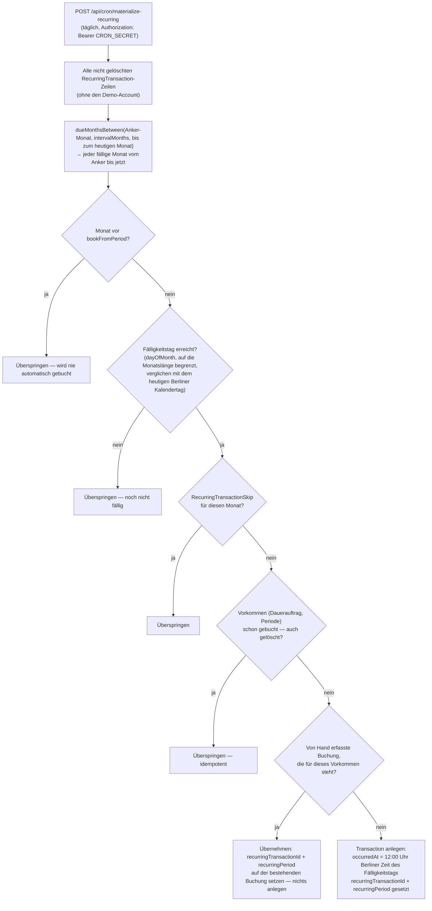
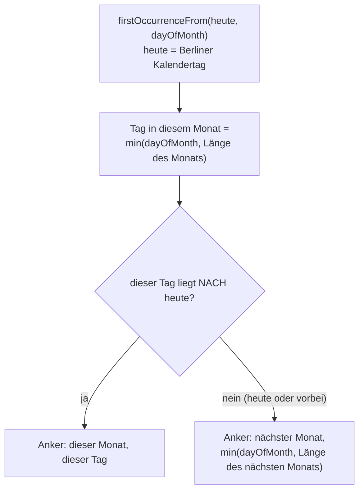
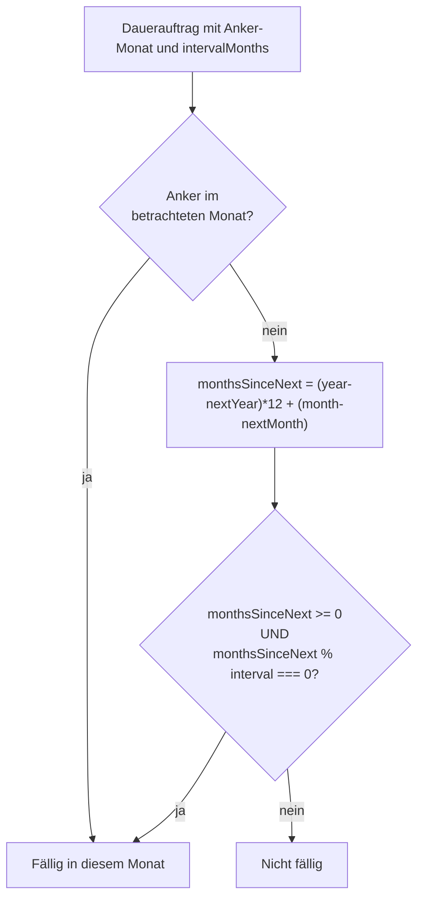

# Wiederkehrende Transaktionen (Daueraufträge)

**Quellen:**
- `apps/web/app/api/recurring-transactions/route.ts`
- `apps/web/app/api/recurring-transactions/[id]/route.ts`
- `apps/web/app/api/recurring-transactions/skips/route.ts`
- `apps/web/app/api/recurring-transactions/yearly/route.ts`, `export/route.ts`
- `apps/web/app/api/transactions/[id]/make-recurring/route.ts` (Buchung → Dauerauftrag)
- `packages/shared/src/recurringSchedule.ts` (Fälligkeit, Anker, Tag im Monat, Untergrenze, Übernahme von Hand erfasster Zahlungen)
- `packages/shared/src/recurringYear.ts`, `recurringExport.ts`, `apps/web/lib/recurringYear.ts` (Jahresmatrix, CSV)
- `apps/web/lib/recurringBooking.ts` (automatisches Buchen)
- `apps/web/lib/recurringPeriods.ts` (welche Vorkommen als gebucht gelten)
- `apps/web/app/api/cron/materialize-recurring/route.ts` (täglicher Cron-Trigger)

Kalender, Einordnung und die Begriffe „gebucht" und „geplant" sind in
[00-grundregeln.md](./00-grundregeln.md) §1, §2 und §4 festgelegt. Alle Kalenderwerte auf dieser
Seite — Anker-Monat, „heute", Fälligkeitstag, Periode — sind Werte in **Europe/Berlin**, unabhängig
von der Zeitzone des Servers.

## Was sind Daueraufträge?

Daueraufträge sind **Vorlagen** für regelmäßige Buchungen (z.B. Miete, Gehalt, Abonnements).

Fällige Vorkommen werden **automatisch als echte `Transaction`-Zeile gebucht**, sobald ihr Tag
erreicht ist: täglich durch den Cron `materialize-recurring` und, für abgeschlossene Monate, beim
Lesen der Auswertungen. Nur ein im laufenden Monat fälliges, noch nicht gebuchtes Vorkommen gilt als
„geplant" und fließt in die Hochrechnung des Dashboards ein (siehe unten).

Zwei Regeln schützen davor, dass dabei etwas doppelt in den Büchern landet:

- **Kein ungefragtes Nachbuchen:** Ein Dauerauftrag, der in der Vergangenheit beginnt, wird erst ab
  dem laufenden Monat gebucht — außer der Nutzer verlangt das Nachbuchen ausdrücklich (siehe
  „Untergrenze").
- **Von Hand erfasste Zahlung:** Wurde die Zahlung schon von Hand eingetragen, wird diese Buchung als
  das Vorkommen übernommen, statt ein zweites Mal zu buchen (siehe „Übernahme").

## Vorkommen: Dauerauftrag + Periode

Ein Vorkommen ist das Paar `(recurringTransactionId, recurringPeriod)`. Die Periode ist der Monat
(`JJJJ-MM`), **für den** gebucht wurde; sie steht als `Transaction.recurringPeriod` auf der Buchung.

- Ein Monat gilt als gebucht, sobald eine Buchung mit dieser `recurringTransactionId` und dieser
  Periode existiert — **auch eine gelöschte** (Tombstone).
- Der Monat von `occurredAt` spielt dafür keine Rolle. Wer die Buchung in einen anderen Monat
  verschiebt oder sie löscht, macht den Monat nicht wieder „offen": er wird nicht erneut gebucht und
  im Dashboard nicht wieder als geplant gezeigt. Eine in den Folgemonat verschobene Buchung
  verdrängt umgekehrt nicht das eigene Vorkommen des Folgemonats.
- Buchungen aus der Zeit vor der Spalte `recurringPeriod` (Wert `null`) zählen für den Berliner Monat
  ihres `occurredAt` (`periodOfBooking` in `lib/recurringPeriods.ts`). Die Migration
  `20261119120000_add_recurring_period` hat bestehende Zeilen nach derselben Regel befüllt.

`loadBookedOccurrenceKeys(recurringIds)` liefert die Schlüssel `"<recurringId>:<JJJJ-MM>"` aller
gebuchten Vorkommen. Dieselbe Funktion beantwortet „schon gebucht?" beim automatischen Buchen, im
Dashboard und in der Budget-Warnung.

## Automatisches Buchen (`materializeDueRecurringTransactions`)



- **Fälligkeit nach Kalendertagen:** Verglichen werden Kalendertage, nicht Zeitpunkte
  (`isOnOrBeforeDate`). Ein Vorkommen ist ab 00:00 Uhr Berliner Zeit seines Tages fällig, auch wenn
  es auf 12:00 Uhr datiert wird.
- **Tag im Monat:** `occurrenceDate` begrenzt `dayOfMonth` auf die Monatslänge (31 → 30 im November,
  28/29 im Februar).
- **Demo-Account:** Daueraufträge des öffentlichen Demo-Kontos (`DEMO_ACCOUNT_ID`) werden nie
  automatisch gebucht.
- **Felder der Buchung:** Konto, Kategorie, Betrag und Beschreibung des Dauerauftrags;
  `taxRelevant` erbt die Steuer-Markierung der Kategorie (wie eine von Hand angelegte Buchung; eine
  gelöschte Kategorie gibt nichts weiter).
- **`?dryRun=true`** schreibt nichts und listet nur, was gebucht bzw. übernommen würde. Antwort in
  beiden Fällen: `{ ok, dryRun, booked, adopted, occurrences }`. `booked` zählt alle Einträge von
  `occurrences`, `adopted` die übernommenen darunter; jeder Eintrag trägt `adopted: true|false`.

**Dieselbe Funktion holt den Tagesbetrieb und die Vergangenheit nach:** `dueMonthsBetween` listet
jeden fälligen Monat vom Anker (`nextOccurrence`) bis heute. Ein Dauerauftrag ohne Untergrenze, der
seit Monaten nie gebucht wurde, bekommt beim ersten Lauf alle fehlenden Monate auf einmal nachgebucht
— mit dem **aktuell hinterlegten Betrag** (kein historischer Betrags-Snapshot). Hat sich ein Betrag
zwischenzeitlich geändert (z.B. Nebenkosten-Abschlag), werden vergangene Monate mit dem aktuellen
Betrag befüllt; die betroffene Buchung muss dann von Hand korrigiert werden.

**Selbstheilung beim Lesen (`catchUpPastRecurringForHousehold`):** `GET /api/analytics/summary`,
`/api/analytics/monthly-review`, `/api/analytics/quarterly` und `/api/analytics/category-year` buchen
vor jeder Berechnung alle fälligen, noch nicht gebuchten Vorkommen **abgeschlossener Monate** des
eigenen Haushalts nach (dieselbe Funktion, auf den Haushalt und bis zum letzten Tag des Vormonats
begrenzt). Diese GET-Anfragen können also schreiben. Der laufende Monat bleibt Aufgabe des Crons und
erscheint bis dahin als „geplant". Hintergrund: Der Cron war in Produktion nie eingerichtet, dadurch
fehlten ab Oktober 2026 alle Daueraufträge im Rückblick und im Übertrag, ohne dass es sichtbar wurde.

**Nebenläufigkeit:** Cron, Selbstheilung und die Übernahme im Dashboard (z.B. zwei
Haushaltsmitglieder öffnen gleichzeitig das Dashboard) können parallel laufen. Gebuchte Vorkommen und
Skips werden vorab gesammelt geladen; für jedes fehlende Vorkommen wird je Dauerauftrag ein
transaktionsgebundener Advisory-Lock (`pg_advisory_xact_lock`) genommen und unter dem Lock dieselbe
Vorkommens-Identität erneut geprüft, sodass jeder Monat höchstens einmal gebucht oder übernommen
wird. Zwei verschiedene Daueraufträge teilen keinen Lock; dass sie nicht dieselbe Buchung übernehmen,
sichert die Übernahme selbst: Sie schreibt nur, wenn die Buchung in diesem Moment noch mit keinem
Dauerauftrag verknüpft und nicht gelöscht ist, und nimmt sonst die nächstbeste. Schlägt ein einzelnes
Vorkommen fehl, wird es geloggt und der Lauf läuft für alle anderen weiter.

**Doppelzählung vermieden:** Sobald ein Vorkommen gebucht oder übernommen ist, zählt es nicht mehr
als „geplant" in `recurringIncomeTotal`/`recurringOutcomeTotal`/`recurringPlannedSavings` (siehe
[04-analytics-summary.md](./04-analytics-summary.md)).

### Untergrenze (`bookFromPeriod`): kein ungefragtes Nachbuchen

`RecurringTransaction.bookFromPeriod` (`JJJJ-MM`, darf leer sein) ist der erste Monat, der automatisch
gebucht werden darf. Vorkommen, deren Periode davor liegt, überspringt der Lauf für immer — auch
`?dryRun=true` listet sie nicht. Leer heißt: keine Untergrenze. Das gilt für alle Daueraufträge, die
vor Einführung der Spalte angelegt wurden; sie verhalten sich wie bisher.

Gesetzt wird die Untergrenze an drei Stellen, jeweils auf den **laufenden Berliner Monat**
(`bookFromPeriodFor` in `recurringSchedule.ts`):

| Auslöser | Regel |
|---|---|
| Anlegen (`POST`) | Liegt die erste Buchung in einem Monat **vor** dem laufenden Monat: laufender Monat. Mit `backfill: true` oder bei erster Buchung im laufenden oder einem späteren Monat: leer. |
| Bearbeiten (`PATCH`) | Nur wenn die Anfrage den Rhythmus ändert — `startDate` weicht vom gespeicherten Anker-Tag ab oder `intervalMonths` vom gespeicherten Wert: wie beim Anlegen, gemessen am (neuen) Anker-Monat. Sonst bleibt der Wert unverändert, auch mit `backfill`. |
| Dauerauftrag aus Buchung (`make-recurring`) | Immer der laufende Monat: die Serie läuft ab jetzt weiter. |

Hintergrund: Ohne Untergrenze buchte ein Startdatum in der Vergangenheit für jeden Monat seit dem
Start eine echte Buchung — ein Tippfehler wie 2016 statt 2026 rund 120 Stück —, und was der Nutzer für
diese Monate von Hand erfasst hatte, stand danach doppelt da. Dasselbe passierte beim Verkürzen des
Intervalls (aus quartalsweise wird monatlich: die Monate dazwischen) und bei „Dauerauftrag aus
Buchung" auf einer älteren Buchung.

**Beispiel am 19. November 2026**, Dauerauftrag mit Startdatum 25. November 2025, monatlich:

| | `bookFromPeriod` | Gebucht wird |
|---|---|---|
| ohne `backfill` | `2026-11` | nichts für November 2025 bis Oktober 2026; der 25. November 2026, sobald er erreicht ist; danach jeden Monat |
| mit `backfill: true` | leer | beim nächsten Lauf November 2025 bis Oktober 2026 (12 Buchungen, heutiger Betrag), dann wie oben |

Der laufende Monat liegt nie vor der Untergrenze — sie wird immer auf den Monat gesetzt, in dem die
Anfrage eintrifft, und die Zeit läuft nur vorwärts. Was das Dashboard für den laufenden Monat als
„geplant" zeigt, wird deshalb auch gebucht; die Berechnung von „geplant" kennt die Untergrenze nicht
und braucht sie nicht. Jahresmatrix und CSV zeigen den Plan aus der Vorlage und damit auch Monate vor
der Untergrenze.

### Übernahme: eine von Hand erfasste Zahlung ist das Vorkommen

Wer die Miete am 2. von Hand einträgt und einen Dauerauftrag für den 3. hat, soll sie nicht zweimal
in den Büchern haben. Bevor der Lauf ein Vorkommen bucht (unter dem Lock, nach der Prüfung „schon
gebucht?"), sucht er deshalb eine von Hand erfasste Buchung, die für dieses Vorkommen steht
(`isAdoptionCandidate`, `pickAdoptionCandidate` in `recurringSchedule.ts`). Eine Buchung kommt in
Frage, wenn **alles** zutrifft:

- sie liegt auf demselben Konto wie der Dauerauftrag;
- sie ist nicht gelöscht und mit **keinem** Dauerauftrag verknüpft (`recurringTransactionId` leer);
- ihr `amountCents` ist exakt der Betrag des Dauerauftrags (mit Vorzeichen);
- sie hat dieselbe Kategorie — hat der Dauerauftrag keine Kategorie: sie hat ebenfalls keine **und**
  dieselbe Beschreibung, ohne Beachtung von Groß-/Kleinschreibung und Leerraum am Rand;
- ihr Berliner Kalendertag liegt höchstens **7 Tage vor oder nach** dem Fälligkeitstag
  (`ADOPTION_WINDOW_DAYS`). Das Fenster reicht über Monatsgrenzen: Die am 28. November überwiesene
  Miete steht für das Vorkommen vom 1. Dezember.

Gibt es mehrere, gewinnt die Buchung, die dem Fälligkeitstag am nächsten liegt; bei gleichem Abstand
die älteste (früheres Datum, dann früher erfasst).

Übernehmen heißt: Auf der bestehenden Buchung werden `recurringTransactionId` und `recurringPeriod`
(die Periode des Vorkommens, nicht der Monat ihres Datums) gesetzt. Betrag, Datum, Beschreibung,
Kategorie, Steuer-Markierung und Belege bleiben, wie der Nutzer sie erfasst hat. Angelegt wird
nichts. Von da an ist das Vorkommen gebucht, mit allen Folgen aus „Vorkommen: Dauerauftrag +
Periode" — auch: Wird die übernommene Buchung gelöscht, bleibt der Monat gebucht.

- **Jede Buchung steht nur für ein Vorkommen.** Zwei Daueraufträge mit gleichem Betrag und gleicher
  Kategorie und eine von Hand erfasste Zahlung: Einer übernimmt sie, der andere bucht regulär.
- **Übersprungene Monate** und Monate vor der Untergrenze übernehmen nichts.
- **Bereits gebuchte Monate** suchen nicht mehr. Eine Zahlung, die von Hand erfasst wurde, obwohl der
  Monat schon automatisch gebucht war, bleibt als eigene Buchung stehen und wird nie nachträglich
  verknüpft oder verändert.
- **Im laufenden Monat schon vor dem Fälligkeitstag:** `GET /api/analytics/summary` ruft nach der
  Selbstheilung `adoptManualBookingsForCurrentMonth` auf. Jedes Vorkommen des Haushalts, das im
  laufenden Monat fällig, weder gebucht noch übersprungen ist und nicht vor der Untergrenze liegt,
  versucht zu übernehmen — auch wenn sein Tag noch nicht erreicht ist. Angelegt wird dabei nie etwas.
  Ohne diesen Schritt zählte das Dashboard die Zahlung bis zum Fälligkeitstag einmal als gebucht und
  einmal als geplant.
- **Antwort des Laufs:** Übernommene Vorkommen stehen mit `adopted: true` in `occurrences`;
  `transactionId` ist die übernommene Buchung.

**Beispiel**, Dauerauftrag „Miete" −950,00 €, Kategorie Wohnen, fällig am 15.:

| Von Hand erfasst | Übernommen? |
|---|---|
| −950,00 €, Wohnen, 8. des Monats | ja (7 Tage vorher) |
| −950,00 €, Wohnen, 7. des Monats | nein (8 Tage vorher) — am 15. wird regulär gebucht |
| −949,99 €, Wohnen, 15. | nein (anderer Betrag) |
| −950,00 €, Sonstiges, 15. | nein (andere Kategorie) |
| −950,00 €, Wohnen, 15., anderes Konto | nein |

### Bekannte Grenzen

- **Von Hand erfasste Zahlung außerhalb der Regel:** Übernommen wird nur, was die Bedingungen oben
  erfüllt. Weicht der Betrag ab (z.B. die Miete wurde erhöht, der Dauerauftrag noch nicht angepasst),
  liegt die Zahlung mehr als 7 Tage vom Fälligkeitstag entfernt oder wurde sie erst erfasst, **nachdem**
  der Monat schon automatisch gebucht war, steht sie doppelt in den Büchern. Abhilfe wie bisher: den
  Monat überspringen (Skip), bevor er gebucht ist, oder die doppelte Buchung löschen.
- **Übernahme ohne Rückfrage:** Eine Buchung mit gleichem Konto, Betrag und Kategorie, die zufällig
  im Fenster liegt und etwas anderes meint, wird ebenfalls übernommen; der Dauerauftrag bucht in
  diesem Monat dann nicht. Es gibt keinen Endpunkt, der eine Verknüpfung wieder löst.
- **Kein Betrags-Snapshot:** siehe oben — nachgebucht wird mit dem heutigen Betrag.
- **Überspringen wirkt nur vor dem Buchen:** Ein Skip verhindert das Buchen eines Monats. Ist der
  Monat schon gebucht, entfernt ein Skip die Buchung nicht; dafür wird die Buchung gelöscht (sie
  bleibt als Tombstone gebucht und kommt nicht wieder).

## Datenmodell

```
RecurringTransaction
├── amountCents    — Vorzeichen wie bei Buchungen (positiv = Geld kommt, negativ = Geld geht)
├── frequency      — immer "MONTHLY" (wird serverseitig gesetzt)
├── intervalMonths — 1-24: Abstand in Monaten (1 = jeden Monat, 3 = quartalsweise)
├── dayOfMonth     — 1-31: Tag des Monats, an dem gebucht wird (auf die Monatslänge begrenzt)
├── nextOccurrence — Anker der Serie (DateTime). Trotz des Namens NICHT "das nächste" Vorkommen
│                    und wird nach einer Buchung nicht weitergeschoben.
└── bookFromPeriod — "JJJJ-MM" oder leer: erster Monat, der automatisch gebucht werden darf
                     (siehe „Untergrenze"). Leer = keine Untergrenze.
```

## Der Anker (`nextOccurrence`)

Der Anker legt fest, **ab welchem Monat** die Serie läuft und in welchem Rhythmus (Anker-Monat +
Vielfache von `intervalMonths`). Die Fälligkeit liest vom Anker nur den Monat; an welchem **Tag**
gebucht wird, bestimmt `dayOfMonth`. Gespeichert wird der Anker immer als 12:00 Uhr Berliner Zeit des
gemeinten Kalendertags.

### Beim Anlegen (`POST /api/recurring-transactions`)

- **Mit `startDate`** (`yyyy-mm-dd`): Das Startdatum ist das Datum der ersten Buchung. `dayOfMonth`
  ist der Tag des Startdatums, sofern nicht zusätzlich ein eigenes `dayOfMonth` übergeben wird.
  `startDate` und `dayOfMonth` sind unabhängige Felder, gebucht wird am `dayOfMonth`
  (`firstOccurrenceOnOrAfter`):
  - Liegt `dayOfMonth` (auf die Länge des Startmonats begrenzt) **am oder nach** dem Tag des
    Startdatums, beginnt die Serie im Monat des Startdatums; der Anker ist das Startdatum.
  - Liegt er **davor**, beginnt die Serie im Folgemonat; der Anker ist der `dayOfMonth` des
    Folgemonats. So wird nie vor dem Datum gebucht, das als erste Buchung eingegeben wurde.

  | Startdatum | dayOfMonth | Erste Buchung | Anker |
  |---|---|---|---|
  | 20. November 2026 | 20 (Standard) | 20. November 2026 | 20. November 2026 |
  | 20. November 2026 | 25 | 25. November 2026 | 20. November 2026 |
  | 20. November 2026 | 5 | 5. Dezember 2026 | 5. Dezember 2026 |
  | 31. Januar 2027 | 30 | 28. Februar 2027 | 28. Februar 2027 |
  | 30. April 2027 | 31 | 30. April 2027 (April hat 30 Tage) | 30. April 2027 |

  Ein Anker in der Zukunft wird erst ab seinem Monat eingerechnet. Liegt die erste Buchung in einem
  Monat vor dem laufenden, wird nur mit `backfill: true` nachgebucht (siehe „Untergrenze").
  `startDate` darf höchstens **10 Jahre** vor oder nach heute liegen (derselbe Tag vor bzw. in
  10 Jahren ist noch erlaubt; `RECURRING_START_MAX_YEARS`), sonst `400` — das fängt Tippfehler wie
  2016 statt 2026 ab.
- **Ohne `startDate`:** `firstOccurrenceFrom(heute, dayOfMonth)` (Standard `dayOfMonth` = 1):



Ein Tag, der **heute** ist, gilt als vorbei: Wer die heutige Zahlung von Hand erfasst und danach den
Dauerauftrag anlegt, soll sie nicht ein zweites Mal gebucht bekommen. Verglichen wird der auf die
Monatslänge begrenzte Tag.

**Beispiel am 10. Juni 2026:**

| dayOfMonth | Anker |
|---|---|
| 15 | 15. Juni 2026 (steht noch bevor) |
| 1 | 1. Juli 2026 (bereits vorbei) |
| 10 | 10. Juli 2026 (heute zählt als vorbei) |
| 31 | 30. Juni 2026 (Juni hat 30 Tage) |

**Beispiel am 30. November 2026:** `dayOfMonth` 30 und 31 liegen beide auf dem 30. November, also
heute — beide Serien beginnen im Dezember (30. bzw. 31. Dezember).

### Beim Bearbeiten (`PATCH /api/recurring-transactions/[id]`)

Der Anker wird nur angefasst, wenn `startDate` oder `dayOfMonth` im Body steht:

- **`startDate`** (hat Vorrang) setzt die Serie neu auf: Anker = dieses Datum. Die Regel „nie vor
  dem Startdatum buchen" aus dem Anlegen gilt hier **nicht**: Das Bearbeiten-Formular schickt den
  gespeicherten Anker bei jedem Speichern mit, und bestehende Anker dürfen einen anderen Tag haben als
  `dayOfMonth`.
- **`dayOfMonth` allein** ändert nur den Tag: Der Anker-Monat bleibt, der Tag wird auf die Länge
  dieses Monats begrenzt. Die Serie behält ihren Rhythmus — bei einem Intervall über 1 bleiben die
  fälligen Monate dieselben, und kein früherer Monat fällt aus der Jahresübersicht oder dem CSV.
- Bereits gebuchte Vorkommen bleiben in beiden Fällen unberührt.

Ob die Anfrage den **Rhythmus ändert**, entscheidet der Vergleich mit dem gespeicherten Stand: ein
`startDate`, das vom Berliner Kalendertag des gespeicherten Ankers abweicht, oder ein
`intervalMonths`, das vom gespeicherten Wert abweicht. Nur dann

- wird `bookFromPeriod` neu bestimmt (siehe „Untergrenze") — aus quartalsweise wird monatlich, ohne
  dass die Monate dazwischen nachgebucht werden; `backfill: true` verlangt das Nachbuchen;
- wird das neue `startDate` auf die 10-Jahres-Grenze geprüft (`400`).

Ein unverändert mitgeschicktes Startdatum und Intervall — der Normalfall beim Speichern des
Formulars — lässt `bookFromPeriod` unverändert und wird nicht geprüft; ein alter Anker, der mehr als
10 Jahre zurückliegt, blockiert das Bearbeiten also nicht.

`DELETE` löscht den Dauerauftrag weich (`deletedAt`). Bereits gebuchte Buchungen bleiben bestehen;
künftige Vorkommen entfallen.

### Aus einer bestehenden Buchung (`make-recurring`)

`POST /api/transactions/[id]/make-recurring` erzeugt aus einer Buchung einen Dauerauftrag und
verknüpft sie (`recurringTransactionId`), beides in einer DB-Transaktion.

- Der Anker ist **nicht** der Ursprungsmonat, sondern
  `addMonthsClamped(Buchungstag, intervalMonths, dayOfMonth?)`: Buchungstag (Kalendertag in
  Europe/Berlin) plus `intervalMonths`, Tag auf die Monatslänge begrenzt (31. Jan + 1 Monat →
  28./29. Feb), gespeichert als 12:00 Uhr Berliner Zeit.
- Die Ursprungsbuchung gilt als das Vorkommen ihres eigenen Berliner Monats: Sie bekommt
  `recurringPeriod` = dieser Monat. Wird sie später in den Folgemonat verschoben, bleibt dessen
  eigenes Vorkommen unberührt.
- `dayOfMonth` des Dauerauftrags ist der übergebene Wert, sonst der Tag der Buchung.
- `bookFromPeriod` ist der laufende Berliner Monat: Die Serie läuft ab jetzt weiter. Aus einer zwei
  Monate alten Buchung entsteht so keine Buchung für den Monat dazwischen — der könnte längst von Hand
  erfasst sein. Der laufende Monat wird gebucht, sobald sein Tag erreicht ist (oder eine von Hand
  erfasste Zahlung übernommen, siehe „Übernahme").
- Bereits verknüpfte Buchungen → `409`.

## Fälligkeit in einem Monat

`isRecurringDueInMonth` (`recurringSchedule.ts`) entscheidet, ob ein Dauerauftrag in einem Monat
fällig ist. Die Aufrufer lesen den Anker-Monat mit `zonedMonth(nextOccurrence)`.



**Beispiel — quartalsweiser Dauerauftrag (intervalMonths=3):**

| Anker-Monat | Betrachteter Monat | monthsSinceNext | % 3 | Fällig? |
|---|---|---|---|---|
| 2026-01 | 2026-01 | 0 | 0 | Ja |
| 2026-01 | 2026-02 | 1 | 1 | Nein |
| 2026-01 | 2026-03 | 2 | 2 | Nein |
| 2026-01 | 2026-04 | 3 | 0 | Ja |
| 2026-01 | 2026-07 | 6 | 0 | Ja |

### Fällig, geplant, gebucht im Dashboard

`GET /api/analytics/summary` teilt die Daueraufträge des laufenden Monats so ein (Code:
`summary/route.ts`, Abschnitt „Daueraufträge"):

| Menge | Bedingung | Verwendung |
|---|---|---|
| fällig (`dueRecurring`) | im laufenden Monat fällig und nicht übersprungen — ob gebucht oder nicht | `recurringDueIncomeTotal`, `recurringDueOutcomeTotal`, `recurringDueCount` |
| geplant (`plannedRecurring`) | fällig **und** für die Periode des laufenden Monats noch nicht gebucht | `recurringTransactions`, `recurringIncomeTotal`, `recurringOutcomeTotal`, `recurringPlannedSavings`, Hochrechnungen |

Bevor die Route diese Mengen bildet, bucht sie abgeschlossene Monate nach und übernimmt im laufenden
Monat von Hand erfasste Zahlungen (siehe „Übernahme"). Ein übernommenes Vorkommen ist gebucht: Es
bleibt in „fällig" und fällt aus „geplant". Die Untergrenze `bookFromPeriod` spielt für beide Mengen
keine Rolle, weil der laufende Monat nie vor ihr liegt.

Einzelheiten in [04-analytics-summary.md](./04-analytics-summary.md).

## Skips — Einmaliges Überspringen

Ein Dauerauftrag kann für einen bestimmten Monat übersprungen werden:

```
RecurringTransactionSkip
├── recurringId  — Verweis auf RecurringTransaction
├── year         — Jahr des zu überspringenden Monats
└── month        — Monat (1-12)

Unique: (recurringId, year, month)
```

Ein übersprungener Monat wird nicht automatisch gebucht, zählt im Dashboard weder als fällig noch als
geplant und steht in Jahresmatrix und CSV mit 0.

## Jahresmatrix (`/yearly`)

`buildRecurringYearMatrix(items, year)` (`@doewe/shared`, `recurringYear.ts`) erzeugt pro Dauerauftrag 12 Monatswerte in Cent (mit Vorzeichen wie gespeichert): Betrag in den Monaten, in denen `isRecurringDueInMonth` zutrifft, sonst 0; übersprungene Monate (Skips des Jahres) sind 0. Daueraufträge mit Anker nach dem Jahr bleiben als Nullzeile erhalten. Die Matrix zeigt den **Plan** aus den Vorlagen, nicht die tatsächlich gebuchten Vorkommen — auch Monate vor der Untergrenze `bookFromPeriod`, die nie automatisch gebucht werden, stehen mit ihrem Betrag darin.

- **Gruppen:** `classifyRecurringKind` — Spar-Kategorie → `savings`, sonst Betrag `>= 0` → `income`, `< 0` → `expense` (dieselbe Reihenfolge wie Grundregeln §2; die Spar-Kategorien kommen aus `loadSavingsCategoryIds`).
- **Summen:** je Gruppe Monatssummen, Jahressumme und `monthlyAverageCents = round(Jahressumme / 12)`; `net` = vorzeichenbehaftete Summe aller Gruppen.
- **Quelle:** `GET /api/recurring-transactions/yearly?year=YYYY`, Darstellung auf der Seite `/yearly`. Ohne `year` gilt das laufende Jahr in Europe/Berlin.

### CSV-Export

`GET /api/recurring-transactions/export?year=YYYY` liefert dieselben Daueraufträge als CSV
(`buildRecurringCsv`). Seite und CSV laden ihre Zeilen über dieselbe Funktion
(`loadRecurringYearItems`) und ordnen deshalb gleich ein — nach Spar-Kategorie und Vorzeichen, nicht
nach `Category.isIncome`.

- Einnahmen werden ausgelassen; zuerst die Ausgaben, dann das Sparen, danach die Zeilen
  „Summe Ausgaben", „Summe Sparen" und „Gesamt".
- Beträge stehen als positive Zahl, wenn Geld das Konto verlässt. Ein Dauerauftrag, der regelmäßig
  aus dem Spartopf entnimmt (positiver Betrag in einer Spar-Kategorie), steht negativ und verringert
  „Summe Sparen".
- Format: Trennzeichen `;`, Dezimalkomma, CRLF, UTF-8 mit BOM; Dateiname `wiederkehrend-<Jahr>.csv`.

## API-Endpunkte

| Methode | Endpoint | Beschreibung |
|---|---|---|
| GET | `/api/recurring-transactions` | Alle Daueraufträge des Haushalts (nach Anker sortiert) |
| POST | `/api/recurring-transactions` | Neuen Dauerauftrag anlegen (`backfill` für das Nachbuchen der Vergangenheit) |
| POST | `/api/transactions/[id]/make-recurring` | Dauerauftrag aus bestehender Buchung anlegen + verknüpfen |
| PATCH | `/api/recurring-transactions/[id]` | Dauerauftrag bearbeiten |
| DELETE | `/api/recurring-transactions/[id]` | Dauerauftrag löschen (Soft-Delete) |
| GET | `/api/recurring-transactions/skips?year=&month=` | Skips für einen Monat |
| POST | `/api/recurring-transactions/skips` | Skip hinzufügen (upsert) |
| DELETE | `/api/recurring-transactions/skips` | Skip entfernen |
| GET | `/api/recurring-transactions/yearly?year=` | Jahresmatrix (Monatsbeträge, Gruppen, Saldo) |
| GET | `/api/recurring-transactions/export?year=` | CSV der wiederkehrenden Ausgaben und Sparraten |
| POST | `/api/cron/materialize-recurring` | Fällige Vorkommen buchen oder übernehmen (Cron, `?dryRun=true` möglich) |
