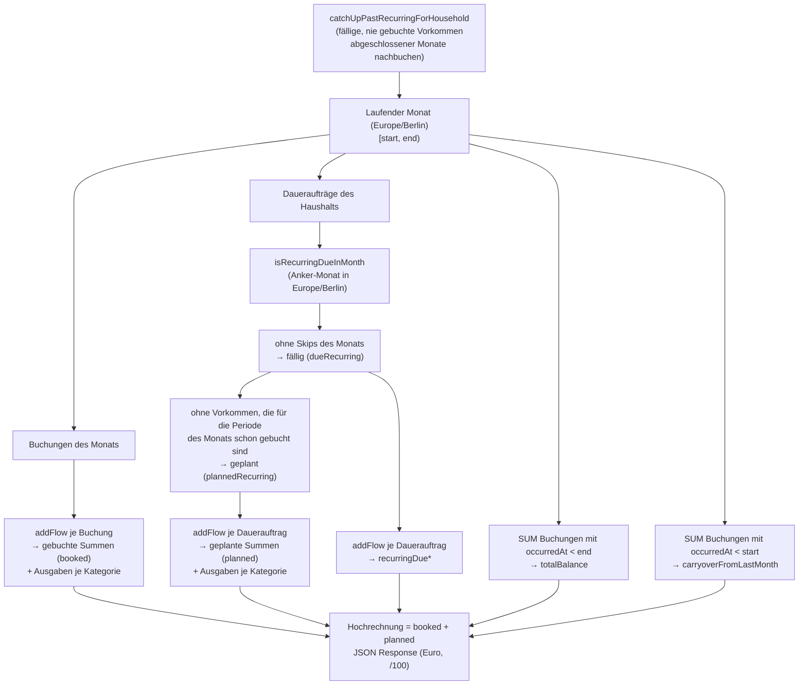

# Analytics Summary — Monatliche Dashboard-Kennzahlen

**Quelle:** `apps/web/app/api/analytics/summary/route.ts`
**Endpoint:** `GET /api/analytics/summary`

## Überblick

Der Summary-Endpoint ist das Herzstück des Dashboards. Er liefert alle Finanzkennzahlen für den
**laufenden Monat** — das Gebuchte und, getrennt davon, die noch nicht gebuchten Daueraufträge des
Monats als Hochrechnung.

Es gelten die [Grundregeln](./00-grundregeln.md):

- **Kalender:** Der laufende Monat ist der Monat von „jetzt" in Europe/Berlin, halboffen
  `[start, end)` (`zonedMonth`, `zonedMonthRange`) — §1.
- **Umfang:** alle Konten des Haushalts; gelöschte Buchungen zählen nicht — §3. Hat der Haushalt kein
  Konto, antwortet die Route mit `404`.
- **Einordnung:** `classifyFlow`/`addFlow` gegen alle Spar-Kategorien des Haushalts — §2.
- **Gebucht und geplant:** §4. Nur dieser Endpoint rechnet Geplantes ein.

Die Route hat keine Query-Parameter.

## Berechnungsfluss



**Schreibender GET:** Der erste Schritt bucht fällige, nie gebuchte Vorkommen abgeschlossener Monate
nach, bevor gerechnet wird (siehe
[03-wiederkehrende-transaktionen.md](./03-wiederkehrende-transaktionen.md), „Selbstheilung beim
Lesen"). Der laufende Monat wird hier nicht gebucht.

## Alle Kennzahlen im Detail

Alle Summen entstehen in Cents; erst für die Antwort wird durch 100 geteilt.

### Kontostände

| Feld | Formel | Beschreibung |
|---|---|---|
| `totalBalance` | `SUM(amountCents WHERE occurredAt < Monatsende)` | Kontostand: alle Buchungen bis zum Ende des laufenden Monats. Für spätere Monate vorerfasste Buchungen zählen nicht. |
| `carryoverFromLastMonth` | `SUM(amountCents WHERE occurredAt < Monatsstart)` | Übertrag = Kontostand am Ende des Vormonats |

### Monatstotale (nur Gebuchtes)

| Feld | Formel | Beschreibung |
|---|---|---|
| `incomeTotal` | Summe der als `income` eingeordneten Buchungen | Einnahmen des Monats; Buchungen einer Spar-Kategorie zählen nicht, auch positive nicht |
| `outcomeTotal` | Summe der als `outcome` eingeordneten Buchungen, als positiver Betrag | Ausgaben ohne Sparen |
| `outcomeTotalExclSavings` | identisch mit `outcomeTotal` | Redundantes Feld |
| `monthlySavingsActual` | Einzahlungen minus Entnahmen der Spar-Kategorien | Gespart, **netto** — kann negativ sein |
| `remaining` | `incomeTotal − outcomeTotal − monthlySavingsActual` | = Summe aller `amountCents` des Monats |

### Daueraufträge des Monats

Zwei Mengen (Definitionen in [03-wiederkehrende-transaktionen.md](./03-wiederkehrende-transaktionen.md),
„Fällig, geplant, gebucht im Dashboard"):

**Fällig** — im laufenden Monat fällig und nicht übersprungen, ob schon gebucht oder nicht. Die
Werte bleiben über den Monat konstant; die Route stellt sie als Grundlage für die Fixkostenquote
bereit.

| Feld | Formel | Beschreibung |
|---|---|---|
| `recurringDueIncomeTotal` | Summe der fälligen Daueraufträge der Klasse `income` | ohne Spar-Daueraufträge |
| `recurringDueOutcomeTotal` | Summe der fälligen Daueraufträge der Klasse `outcome`, positiv | ohne Spar-Daueraufträge |
| `recurringDueCount` | Anzahl der fälligen Daueraufträge | **mit** Spar-Daueraufträgen |

**Geplant** — fällig und für die Periode des laufenden Monats noch nicht gebucht. Ein Vorkommen, das
schon gebucht wurde, steckt in den Monatstotalen (oder wurde vom Nutzer gelöscht bzw. verschoben) und
zählt hier nicht mehr — erkannt über `(recurringTransactionId, recurringPeriod)`, nicht über den
Monat von `occurredAt`.

| Feld | Formel | Beschreibung |
|---|---|---|
| `recurringTransactions` | Liste der geplanten Daueraufträge | je `{ id, description, amountCents, categoryId, dayOfMonth }`; `amountCents` bleibt in Cents |
| `recurringIncomeTotal` | Summe der geplanten Daueraufträge der Klasse `income` | ohne Spar-Daueraufträge |
| `recurringOutcomeTotal` | Summe der geplanten Daueraufträge der Klasse `outcome`, positiv | ohne Spar-Daueraufträge |
| `recurringPlannedSavings` | geplante Spar-Daueraufträge, netto (Einzahlungen minus Entnahmen) | kann negativ sein |

### Projektionen (Gebuchtes + Geplantes)

| Feld | Formel | Beschreibung |
|---|---|---|
| `projectedIncomeTotal` | `incomeTotal + recurringIncomeTotal` | Hochrechnung Einnahmen |
| `projectedOutcomeTotal` | `outcomeTotal + recurringOutcomeTotal` | Hochrechnung Ausgaben (ohne Sparen) |
| `projectedSavingsTotal` | `monthlySavingsActual + recurringPlannedSavings` | Hochrechnung Sparen, netto |
| `projectedRemaining` | `projectedIncomeTotal − projectedOutcomeTotal − projectedSavingsTotal` | Voraussichtlicher Saldo **des Monats**, ohne Übertrag |

Ist am Monatsende alles gebucht, sind die geplanten Summen 0 und die Projektionen gleich den
Monatstotalen — und damit gleich dem Rückblick desselben Monats (Grundregeln §6).

### Kategorien-Ausgaben

```typescript
outgoingByCategory: [
  { id, name, amount }  // amount in Euro
]
```

- Gebuchte Ausgaben plus geplante Dauerauftrags-Ausgaben, je Kategorie zusammengefasst
- `id: "uncategorized"` (Name `"Uncategorized"`) = Buchungen **und geplante Daueraufträge** ohne
  Kategorie
- Buchungen der Spar-Kategorien und Einnahmen (auch Erstattungen) sind **nicht enthalten**
- Die Summe aller `amount` ist `projectedOutcomeTotal`

### Budget vs. Ist

```typescript
categoryBudgets: [
  {
    categoryId,
    name,
    budget,   // effektives Budget in Euro
    spent,    // Ausgaben der Kategorie in Euro
    diff      // (spentCents - budgetCents) / 100
              // positiv = über Budget, negativ = unter Budget
  }
]
```

- `budget` ist das **effektive** Budget aus `loadEffectiveCategoryBudgets`: der Budget-Plan der
  Kategorie, sonst — nur für Kategorien ohne Plan — ein Monats-`Budget` dieses Monats. Einzelheiten
  in [06-budgets.md](./06-budgets.md).
- `spent` ist derselbe Wert wie in `outgoingByCategory`: gebuchte Ausgaben **plus geplante
  Daueraufträge** der Kategorie.
- Jede Kategorie mit Budget erscheint, auch bei `spent = 0`.

### Geplantes Sparen und abgeschlossene Ziele

| Feld | Formel | Beschreibung |
|---|---|---|
| `plannedSavings` | `SUM(Budget.amountCents)` über alle Sparziele (`categoryId = null`) des Haushalts mit Zielmonat = laufender Monat und `completedAt = null` | Mehrere Ziele im selben Monat werden addiert. Ziele ohne Termin zählen nicht. |
| `completedGoals` | Sparziele, deren `completedAt` im laufenden Monat liegt | je `{ title, target, spent, completedAt }`, Euro, nach `completedAt` aufsteigend — unabhängig vom Zielmonat |
| `completedGoalsSpent` | Summe der `spentCents` dieser Ziele | Euro |

Bereits **abgeschlossene** Sparziele zählen nicht mehr als geplante Ersparnis des Monats (siehe
[07-sparziele.md](./07-sparziele.md), Abschnitt "Completion-Lebenszyklus").

## Was das Dashboard daraus ableitet

Das verfügbare Budget und der voraussichtliche Rest werden nicht vom Endpoint geliefert, sondern aus
seinen Feldern mit der reinen Funktion `computeAvailableBudget`
(`packages/shared/src/dashboardBudget.ts`, getestet in `dashboardBudget.test.ts`) berechnet:

| Wert | Formel |
|---|---|
| `savingsNet` | `projectedSavingsTotal` |
| `totalSavingsTransfer` | `max(0, savingsNet)` — Einzahlungen |
| `savingsWithdrawn` | `max(0, −savingsNet)` — Entnahmen, die ins Budget zurückfließen |
| `availableBudget` | `carryoverFromLastMonth + projectedIncomeTotal + savingsWithdrawn` |
| `projectedSpent` | `projectedOutcomeTotal + totalSavingsTransfer` |
| `projectedLeft` | `availableBudget − projectedSpent` |
| `spentPercent`, `expensesPercent`, `savedPercent` | Anteile am `availableBudget`, auf ganze Prozent gerundet; `spentPercent` und `expensesPercent` höchstens 100, `savedPercent` höchstens `100 − expensesPercent`; alle 0, wenn `availableBudget <= 0` |
| `overspent` | `max(0, projectedSpent − availableBudget)` |

Der Übertrag wird bewusst nicht bei 0 abgeschnitten: ein negativer Übertrag verringert das
verfügbare Budget. `projectedLeft` ist damit `carryoverFromLastMonth + projectedRemaining` — der
Übertrag kommt hinzu, `projectedRemaining` allein ist nicht die Zahl, die das Dashboard als
voraussichtlichen Rest zeigt. Die Funktion nimmt Euro-Werte entgegen, rechnet aber in Cents (siehe
[01-geld-cents.md](./01-geld-cents.md)).

## Feld `daily`

Die Antwort enthält weiterhin `daily: { labels, income, outcome, savings }` — je Berliner Kalendertag
des Monats die kumulierten Einnahmen, Ausgaben und der Sparstand in Euro (geplante Daueraufträge an
ihrem `dayOfMonth`; die Sparlinie beginnt beim Netto-Sparstand vor dem Monat und wird um ein Defizit
`max(0, Ausgaben − Einnahmen)` gekürzt, nie unter 0). **Keine Oberfläche liest dieses Feld**; es ist
nicht Teil des Abgleichs in Grundregeln §6.

## Vollständiger Response

```typescript
{
  totalBalance: number,
  carryoverFromLastMonth: number,
  incomeTotal: number,
  outcomeTotal: number,
  outcomeTotalExclSavings: number,   // identisch mit outcomeTotal (Redundanz)
  monthlySavingsActual: number,      // netto, kann negativ sein
  remaining: number,
  plannedSavings: number,
  completedGoals: { title, target, spent, completedAt }[],
  completedGoalsSpent: number,
  projectedIncomeTotal: number,
  projectedOutcomeTotal: number,
  projectedRemaining: number,
  outgoingByCategory: { id, name, amount }[],
  categoryBudgets: { categoryId, name, budget, spent, diff }[],
  recurringTransactions: { id, description, amountCents, categoryId, dayOfMonth }[],  // nur geplante
  recurringIncomeTotal: number,
  recurringOutcomeTotal: number,
  recurringPlannedSavings: number,
  recurringDueIncomeTotal: number,
  recurringDueOutcomeTotal: number,
  recurringDueCount: number,
  projectedSavingsTotal: number,     // monthlySavingsActual + recurringPlannedSavings
  daily: { labels, income, outcome, savings }
}
```

Alle Geldfelder sind Euro, außer `recurringTransactions[].amountCents`.

## Simulationsbeispiel

**Ausgangslage — Juni 2026:**
- Kontostand Ende Mai: 1.500,00 €
- Gehaltseingang am 1.6.: 3.000,00 €
- Miete am 3.6. (von Hand gebucht, kein Dauerauftrag): -1.200,00 €
- Sparbuchung am 5.6.: -500,00 € (Kategorie "Sparen")
- Dauerauftrag Streaming am 15.6. (noch nicht gebucht): -15,00 €
- Dauerauftrag Sparplan am 28.6. (Kategorie "Sparen", noch nicht gebucht): -200,00 €

| Feld | Berechnung | Wert |
|---|---|---|
| `totalBalance` | 1500 + 3000 - 1200 - 500 | 2800,00 € |
| `carryoverFromLastMonth` | 1500 | 1500,00 € |
| `incomeTotal` | 3000 | 3000,00 € |
| `outcomeTotal` | 1200 (Miete) | 1200,00 € |
| `monthlySavingsActual` | 500 (bereits gebucht) | 500,00 € |
| `remaining` | 3000 - 1200 - 500 | 1300,00 € |
| `recurringOutcomeTotal` | 15 (Streaming) | 15,00 € |
| `recurringPlannedSavings` | 200 (Sparplan-DA) | 200,00 € |
| `recurringDueOutcomeTotal` | 15 (Streaming; der Sparplan ist keine Ausgabe) | 15,00 € |
| `recurringDueCount` | Streaming + Sparplan | 2 |
| `projectedOutcomeTotal` | 1200 + 15 | 1215,00 € |
| `projectedSavingsTotal` | 500 + 200 | 700,00 € |
| `projectedRemaining` | 3000 - 1215 - 700 | 1085,00 € |

Daraus im Dashboard (`computeAvailableBudget`):

| Wert | Berechnung | Wert |
|---|---|---|
| `availableBudget` | 1500 + 3000 + 0 | 4500,00 € |
| `projectedSpent` | 1215 + 700 | 1915,00 € |
| `projectedLeft` | 4500 - 1915 | 2585,00 € |

Wird der Streaming-Dauerauftrag am 15.6. gebucht, wandern die 15,00 € von `recurringOutcomeTotal`
nach `outcomeTotal`; `projectedOutcomeTotal`, `recurringDueOutcomeTotal` und `projectedLeft` bleiben
gleich.
