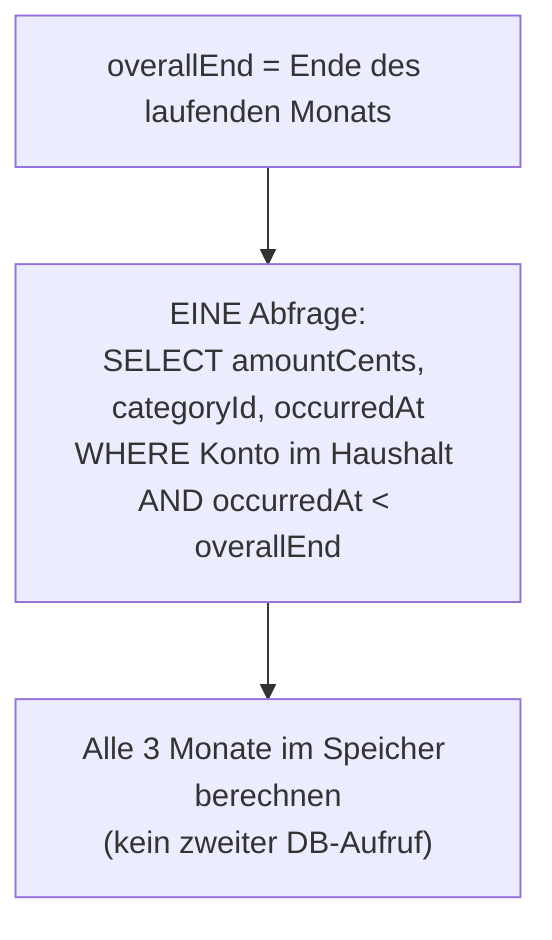
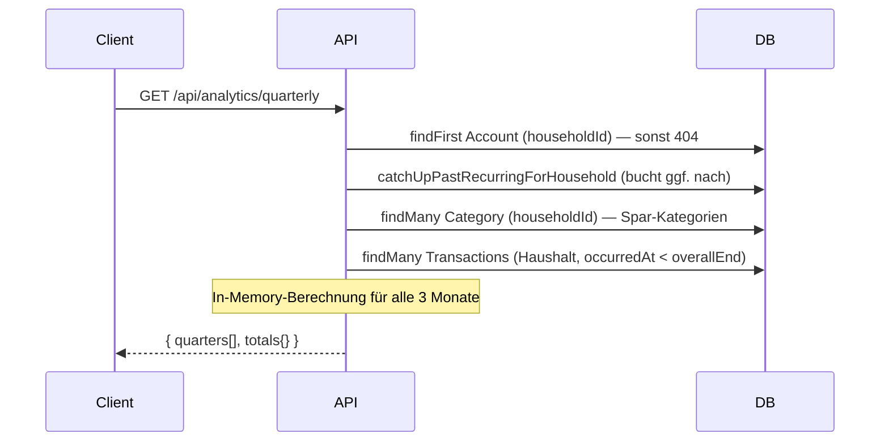

# Analytics Quarterly — Quartalübersicht

**Quelle:** `apps/web/app/api/analytics/quarterly/route.ts`
**Endpoint:** `GET /api/analytics/quarterly`

## Zweck

Zeigt die Finanzdaten der **letzten 3 Monate** (inkl. aktuellem Monat) für einen Vergleich über Zeit.

Es gelten die [Grundregeln](./00-grundregeln.md): Monate nach dem Kalender Europe/Berlin (§1),
Einordnung über `addFlow` (§2), alle Konten des Haushalts ohne gelöschte Buchungen (§3), nur
Gebuchtes — geplante Daueraufträge zählen hier nicht (§4). Jede Spalte entspricht dem Rückblick
desselben Monats (§6). Hat der Haushalt kein Konto, antwortet die Route mit `404`.

## Zeitraum-Berechnung

```typescript
// Letzte 3 Monate inkl. aktuellem Monat (App-Kalender), je halboffen [start, end)
const current = zonedMonth(now);
const months = [-2, -1, 0].map((delta) => {
  const ref = shiftMonth(current, delta);
  return { ...ref, ...zonedMonthRange(ref.year, ref.month) };
});
```

**Beispiel am 10. Juni 2026:** Monate = `[April 2026, Mai 2026, Juni 2026]`

`shiftMonth` rechnet über den Jahreswechsel hinweg; „aktueller Monat" ist der Berliner Monat. Am
1. eines Monats um 00:30 Uhr Berliner Zeit (in UTC noch der Vormonat) ist bereits der neue Monat der
aktuelle.

## Selbstheilung vor dem Rechnen

Wie `summary`, `monthly-review` und `category-year` bucht die Route zuerst fällige, nie gebuchte
Vorkommen von Daueraufträgen **abgeschlossener** Monate nach
(`catchUpPastRecurringForHousehold`, siehe
[03-wiederkehrende-transaktionen.md](./03-wiederkehrende-transaktionen.md)). So sehen die parallel
geladenen Dashboard-Kacheln dieselben Buchungen. Der GET kann dadurch schreiben.

## Datenbankabfrage (optimiert)



**Performance-Entscheidung:** Statt je Monat eigene Abfragen wird einmal alles abgefragt und im Speicher iteriert — der kumulative Kontostand braucht ohnehin alle Buchungen vor dem ersten Monat. Für große Transaktionshistorien kann das viel Speicher verbrauchen.

## Berechnungslogik pro Monat

```typescript
const flows = emptyFlowTotals();
let balance = 0;

for (const t of allTxs) {
  const tMs = t.occurredAt.getTime();
  if (tMs >= endMs) continue;
  balance += t.amountCents; // kumulativer Kontostand bis Monatsende
  if (tMs >= startMs) addFlow(flows, t, savingsIds);
}
```

| Feld | Formel | Beschreibung |
|---|---|---|
| `incomeCents` | Summe der als `income` eingeordneten Buchungen des Monats | Einnahmen des Monats |
| `outcomeCents` | Summe der als `outcome` eingeordneten Buchungen, positiv | Ausgaben des Monats (ohne Sparen) |
| `savingsCents` | Einzahlungen minus Entnahmen der Spar-Kategorien | Sparen des Monats, **netto** — kann negativ sein |
| `balanceCents` | `SUM(alle Buchungen vor Monatsende)` | Kumulativer Kontostand am Monatsende |

**Wichtig:** `balance` akkumuliert über die gesamte Transaktionshistorie bis zum Monatsende — nicht nur die Transaktionen des jeweiligen Monats. `balanceCents` eines Monats ist der „Kontostand Ende" des Rückblicks für diesen Monat; für den laufenden Monat ist es `totalBalance` des Dashboards.

## Response-Format

```typescript
{
  quarters: [
    {
      month: number,        // 1-12
      year: number,
      incomeCents: number,
      outcomeCents: number,
      savingsCents: number,
      balanceCents: number  // kumulativer Kontostand am Ende dieses Monats
    },
    // ... 3 Einträge gesamt, ältester zuerst
  ],
  totals: {
    incomeCents: number,    // Summe der 3 Monate
    outcomeCents: number,
    savingsCents: number
    // kein balanceCents-Total — würde keinen Sinn ergeben
  }
}
```

**Achtung:** Alle Werte im Response sind in **Cents** (Integer), NICHT in Euro. Das unterscheidet sich vom Summary-Endpoint.

## Diagramm: Datenfluss



## Simulationsbeispiel

**Aktueller Monat: Juni 2026**, Kontostand Ende März: 4.000,00 €

| Monat | Einnahmen | Ausgaben | Sparen | Kontostand am Monatsende |
|---|---|---|---|---|
| April 2026 | 3.000,00 € | 1.500,00 € | 300,00 € | 5.200,00 € |
| Mai 2026 | 3.000,00 € | 1.800,00 € | 300,00 € | 6.100,00 € |
| Juni 2026 | 3.000,00 € | 1.200,00 € | 500,00 € | 7.400,00 € |
| **Gesamt** | **9.000,00 €** | **4.500,00 €** | **1.100,00 €** | — |

Werte im Response in Cents: `incomeCents: 900000`, `outcomeCents: 450000`, etc.
