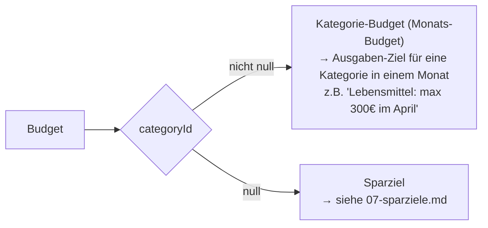

# Budgets — Ziele vs. tatsächliche Ausgaben

**Quellen:**
- `apps/web/app/api/budgets/route.ts`
- `apps/web/app/api/analytics/summary/route.ts` (Budget-Auswertung)
- `apps/web/app/api/analytics/category-year/route.ts`, `packages/shared/src/categoryYear.ts` (Jahresübersicht nach Kategorien)
- `apps/web/app/api/budget-plans/` (Budget-Pläne), `apps/web/lib/categoryBudgets.ts`
- `packages/shared/src/budgetDistribution.ts` (Verteilung, Auflösung)
- `apps/web/lib/budgetAlerts.ts` (Budget-Warnung per Push)

„Ausgegeben" je Kategorie ist überall dieselbe Zahl — Budgets, Dashboard, Rückblick,
Jahresübersicht, Budget-Warnung ([00-grundregeln.md](./00-grundregeln.md) §6): die als `outcome`
eingeordneten Buchungen der Kategorie im Berliner Kalendermonat, über alle Konten des Haushalts.
Erstattungen mindern sie nicht, Buchungen einer Spar-Kategorie sind keine Ausgaben (§2).

## Was ist ein Budget?

Ein Budget definiert einen **Ziel-Betrag** für eine Kategorie in einem bestimmten Monat.

```
Budget
├── accountId   — Konto
├── categoryId  — Kategorie (null = Sparziel)
├── month       — 1-12 (bei Sparzielen ohne Termin null)
├── year        — (bei Sparzielen ohne Termin null)
├── amountCents — Ziel-Betrag (bei Sparzielen optional)
└── title       — optionaler Titel (Default "")
```

`POST /api/budgets` prüft `amountCents` nur auf Ganzzahligkeit — auch 0 und negative Werte werden
angenommen. Ein Budget `<= 0` wirkt in der Jahresübersicht und in der Budget-Warnung wie kein Budget.

**Unique-Constraint:** `(accountId, categoryId, month, year)` — pro Konto, Kategorie und Monat nur
ein Budget. Für Zeilen ohne Kategorie (`categoryId = null`, Sparziele) greift der Constraint nicht,
weil `NULL`-Werte in einem Unique-Index als verschieden gelten: Ein Konto kann mehrere Sparziele im
selben Monat haben.

## Zwei Budget-Typen



## Budget-Pläne (CategoryBudgetPlan)

Ein **Plan** ist ein dauerhaftes Budget je Kategorie (höchstens einer pro Kategorie, nicht für Spar- und Einnahmenkategorien):

- `MONTHLY` — `amountCents` gilt in jedem Monat.
- `YEARLY` — `amountCents` ist der Jahresbetrag und wird auf die 12 Monate verteilt.

**Verteilung (YEARLY)**, alles in Integer-Cent, Gewichte `w[i] = max(0, available[i])`, `available` = geglättete Verfügbarkeit (`smoothedAvailablePerMonth`): Jahreseinnahmen der Daueraufträge gleichmäßig `round(income.totalCents / 12)` plus die Fixkosten und Sparraten des jeweiligen Monats (`expenses`/`savings.monthlyTotalsCents[m]`, beide negativ gespeichert):

```
W = Σ w[i]                         (W <= 0 → alle Gewichte 1, also gleichmäßig)
share[i] = floor(yearly * w[i] / W)
Rest r = yearly - Σ share[i]       (0..11 Cent)
→ der komplette Rest geht auf den Monat mit dem größten Gewicht (Gleichstand: kleinster Index)
```

Die Summe der 12 Monatsbeträge ist immer exakt `yearly`; Monate ohne Verfügbarkeit erhalten 0 (außer im Gleichgewichts-Fallback).

**Reihenfolge der effektiven Budgets** (`loadEffectiveCategoryBudgets`, `resolveEffectiveBudgets`):

1. Plan der Kategorie (MONTHLY: Betrag, YEARLY: Anteil des Monats)
2. Ein Monats-`Budget` (Kategorie, Monat, Jahr) überschreibt den Plan **nicht**: der Plan hat Vorrang
3. Ein Monats-`Budget` gilt nur als Fallback für Kategorien **ohne** Plan. Gelesen werden die Zeilen aller Konten des Haushalts; haben mehrere Konten eine Zeile für dieselbe Kategorie und denselben Monat, ist das Budget des Haushalts ihre Summe
4. Kategorien ohne Plan und ohne Monats-Budget haben kein Budget

Pläne von soft-gelöschten Kategorien und soft-gelöschte Pläne werden ignoriert. Die Jahresmatrix wird nur geladen, wenn ein YEARLY-Plan existiert.

**Kategorie zusammenführen/löschen:** Beim Merge (`PATCH /api/categories/:id` mit `mergeIntoCategoryId`) und beim Löschen mit Fallback (`DELETE`, `fallbackCategoryId`/`fallbackName`) folgt der Plan der Quellkategorie in derselben Transaktion: Hat die Zielkategorie keinen aktiven Plan, wird der Quellplan (gleiche `id`) auf das Ziel umgehängt (eine soft-gelöschte Plan-Zeile des Ziels wird vorher hart gelöscht, da `categoryId` unique ist). Hat das Ziel einen aktiven Plan, bleibt dieser unverändert und der Quellplan wird hart gelöscht.

**Rückwirkend — bekannte Grenzen:**

- Pläne gelten ohne Gültigkeitsbeginn für alle Monate und Jahre, auch für abgeschlossene (Monatsrückblick). Ändert man einen Plan, ändern sich damit auch die Budgets vergangener Monate.
- Die Monatsanteile eines `YEARLY`-Plans werden bei jedem Lesen aus den **heutigen** Daueraufträgen des Jahres abgeleitet (`loadRecurringYearMatrix`). Wird ein Dauerauftrag angelegt, geändert, gelöscht oder übersprungen, verschieben sich die Monatsanteile — auch die bereits abgeschlossener Monate. Die Jahressumme bleibt gleich.

**Angebunden:** `GET /api/analytics/summary` (`categoryBudgets`, auch bei `spent = 0`), `GET /api/analytics/monthly-review` (`budgetCents`; Kategorien nur mit Budget erscheinen mit `transactions: []`) und `GET /api/analytics/category-year` (`budgetMonthlyCents`).

**Nicht angebunden:** die Budget-Warnung per Push — siehe Abschnitt „Budget-Warnung".

## Budget-Auswertung im Dashboard

Im Summary-Endpoint wird pro Kategorie-Budget berechnet:

```typescript
// categoryBudgetsRaw: Record<categoryId, effektives Budget in Cent> (Plan hat Vorrang, Monats-Budget nur Fallback ohne Plan)
const categoryBudgets = Object.entries(categoryBudgetsRaw).map(([categoryId, budgetCents]) => {
  const spentCents = byCategoryCents[categoryId] ?? 0;
  return {
    categoryId,
    name: updatedNameMap[categoryId] ?? categoryId,
    budget: budgetCents / 100,
    spent: spentCents / 100,
    diff: (spentCents - budgetCents) / 100
  };
});
```

| Feld | Bedeutung |
|---|---|
| `budget` | Effektives Budget des laufenden Monats |
| `spent` | Gebuchte Ausgaben + geplante Dauerauftrags-Ausgaben dieser Kategorie |
| `diff` | `spent - budget`: positiv = über Budget, negativ = unter Budget |

**Was in `spent` einfließt:**
- Gebuchte Ausgaben dieser Kategorie im laufenden Monat (Klasse `outcome`, alle Konten des Haushalts)
- **Geplante** Daueraufträge dieser Kategorie: im Monat fällig, nicht übersprungen und für die Periode des Monats noch nicht gebucht. Ein bereits gebuchtes Vorkommen steckt in den gebuchten Ausgaben und wird nicht noch einmal addiert (siehe [03-wiederkehrende-transaktionen.md](./03-wiederkehrende-transaktionen.md)).

Im Dashboard ist `spent` damit eine Hochrechnung bis Monatsende. Im Rückblick (`spentCents`) und in der Jahresübersicht steht nur Gebuchtes; nach Monatsende sind die Zahlen gleich.

## Geplantes Sparen (plannedSavings)

```typescript
const plannedBudgetAgg = await prisma.budget.aggregate({
  where: { ...inHousehold, categoryId: null, month, year, completedAt: null },
  _sum: { amountCents: true }
});
const plannedSavings = (plannedBudgetAgg._sum.amountCents ?? 0) / 100;
```

- Summiert die Zielbeträge aller **aktiven** Sparziele des Haushalts, deren Zielmonat der laufende Monat ist — es können mehrere sein
- Abgeschlossene Ziele (`completedAt` gesetzt) und Ziele ohne Termin zählen nicht
- Der Endpoint verrechnet den Wert nicht mit `monthlySavingsActual`; den Vergleich von geplantem und tatsächlichem Sparen bildet das Dashboard aus beiden Feldern

## Budget-Warnung (Push)

`checkBudgetAlerts` (`lib/budgetAlerts.ts`) wird nach `POST /api/transactions` aufgerufen und sendet einen Push, wenn die Kategorie der Buchung 80 % oder 100 % ihres Budgets erreicht hat. Gemeldet wird nur die höchste erreichte Schwelle, jede Schwelle je Budget und Monat höchstens einmal (`BudgetAlertLog`). Nutzer mit abgeschaltetem `notifyBudgetAlerts` bekommen nichts.

- **Ausgegeben** ist dieselbe Zahl wie `spent` im Dashboard: gebuchte Ausgaben der Kategorie im Berliner Monat der Buchung, alle Konten des Haushalts, plus geplante Daueraufträge der Kategorie.
- **Bekannte Grenze — nur Monats-Budgets:** Als Budget liest die Warnung ausschließlich eine Monats-`Budget`-Zeile (Kategorie, Monat, Jahr) auf dem Konto der Buchung. **Budget-Pläne lösen nie eine Warnung aus**, obwohl die Oberfläche unter `/budgets` nur Pläne anlegt — der `BudgetAlertLog` hängt an `budgetId`.
- Andere Wege, auf denen Buchungen entstehen (Beleg-Scan, Bearbeiten, Sync, automatisch gebuchte Daueraufträge), rufen die Prüfung nicht auf.

## API

| Methode | Endpoint | Beschreibung |
|---|---|---|
| GET | `/api/budgets` | Alle `Budget`-Zeilen des Haushalts, auch Sparziele (Jahr und Monat absteigend) |
| POST | `/api/budgets` | Neues Monats-Budget anlegen |
| GET/POST | `/api/budget-plans` | Budget-Pläne lesen (`?year=`, Standard: laufendes Jahr in Europe/Berlin) und anlegen |
| PATCH/DELETE | `/api/budget-plans/[id]` | Plan ändern oder weich löschen |

**POST-Body `/api/budgets`:**
```typescript
{
  accountId: string,
  categoryId?: string,  // fehlt = Zeile ohne Kategorie (Sparziele entstehen sonst über /api/saving-plan)
  month: number,        // 1-12
  year: number,
  amountCents: number   // Integer, keine weitere Prüfung
}
```

## Oberfläche: Seite `/budgets`

Die Seite `/budgets` (Navigation: „Budgets") verwaltet die Budget-Pläne je Kategorie. Pro budgetierbarer Kategorie wählt man „Monatlich" oder „Jährlich" und gibt einen Betrag ein (Eingabe deutsch oder englisch, z. B. `1.234,56` oder `12.5`, geparst mit `parseMoneyInput` aus `@doewe/shared`). Bei „Jährlich" zeigt eine Vorschau die 12 Monatswerte; das Jahr (`?year=`) bestimmt die Verteilung, da sie vom monatlich verfügbaren Geld der Daueraufträge dieses Jahres abhängt. Speichern/Entfernen laufen über `/api/budget-plans`; danach werden Dashboard und Rückblick neu geladen.

## Jahresblick: Budget-Status je Kategorie und Monat

Die Seite `/yearly` zeigt die tatsächlichen Buchungen je Kategorie und Monat (`GET /api/analytics/category-year`, `buildCategoryYearMatrix`) gegen das effektive Monatsbudget (`loadEffectiveCategoryBudgetsForYear`: Plan vor altem Monats-`Budget`; ein altes Budget gilt nur in den Monaten, für die eine Zeile existiert, sonst gibt es dort kein Budget).

**Gruppen und Beträge:**

- Jahr und Monat sind der Berliner Kalender von `occurredAt` (Grundregeln §1); alle Konten des Haushalts.
- Die Gruppe ist eine Eigenschaft der **Buchung**, nicht der Kategorie: `classifyFlow` ordnet jede Buchung einzeln ein (Grundregeln §2), `Category.isIncome` entscheidet nichts. Eine Kategorie kann deshalb gleichzeitig eine Zeile unter Einnahmen (Erstattungen) und eine unter Ausgaben haben.
- Ausgaben-Zeilen sind **brutto**: eine Erstattung mindert sie nicht. Spar-Zeilen sind netto (Einzahlungen minus Entnahmen, können negativ sein).
- Buchungen ohne Kategorie oder mit einer gelöschten Kategorie stehen als Zeile `uncategorized`.
- Die Gruppensummen eines Monats entsprechen Einnahmen, Ausgaben und Gespart des Rückblicks für diesen Monat (Grundregeln §6).
- Vor dem Rechnen werden fällige, nie gebuchte Vorkommen abgeschlossener Monate nachgebucht (wie im Dashboard).

**Status je Monats- und Summenzelle** (`data-budget-status`):

| Status | Bedingung |
|---|---|
| `over` | Ausgabe **strikt größer** als ein Budget > 0 (genau auf Budget ist nicht „über") |
| `warn` | nicht über, aber Ausgabe >= **85 %** des Budgets (`ausgabe * 100 >= budget * 85`, ganzzahlig) |
| `ok` | unter 85 % des Budgets |
| `none` | kein Budget (oder Budget <= 0) in dem Monat bzw. für die Kategorie |

Die Summenzelle vergleicht nur die Monate mit Budget gegen deren Budgetsumme (`overYear`); Ausgaben in Monaten ohne Budget zählen nicht. Farbe ist nie alleiniger Bedeutungsträger: `over`/`warn` tragen zusätzlich unsichtbaren Text für Screenreader, eine Legende erklärt die Farben.

## Hinweis: Budget-Modell wird auch für Sparpläne verwendet

Das `Budget`-Modell wird **doppelt genutzt**:

1. Als **Monats-Budget** (Kategorie-Budget): über `/api/budgets`
2. Als **Sparziel** (Saving Plan): über `/api/saving-plan`

Der Unterschied:
- Kategorie-Budget: `categoryId` gesetzt, `title` meist leer
- Sparziel: `categoryId = null`, `title` immer gesetzt, Monat/Jahr = Zieltermin (optional)

Die Sparplan-Routen behandeln nur Zeilen ohne Kategorie; ein Kategorie-Budget liefert dort `404`.

Siehe [07-sparziele.md](./07-sparziele.md) für die Sparziel-Logik.
