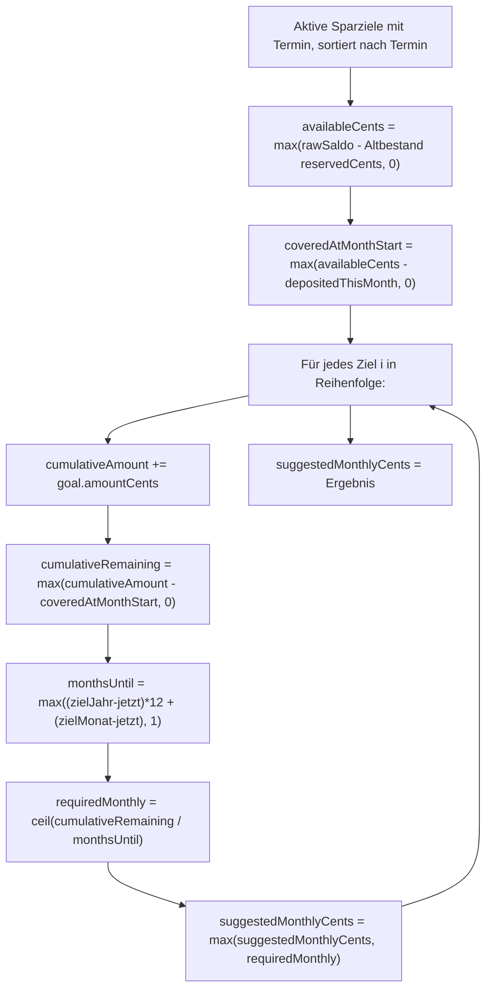

# Sparpläne und Sparziele

**Quelle:** `apps/web/app/api/saving-plan/route.ts`, `apps/web/app/api/saving-plan/[id]/route.ts`, `apps/web/app/api/saving-plan/[id]/complete/route.ts`, `apps/web/app/api/saving-plan/withdraw/route.ts`, `apps/web/app/api/saving-plan/compute.ts` (Berechnung), `apps/web/app/api/saving-plan/savings.ts` (Spartopf)
**Endpoints:** `GET/POST /api/saving-plan`, `GET/PATCH/DELETE /api/saving-plan/[id]`, `POST/DELETE /api/saving-plan/[id]/complete`, `POST /api/saving-plan/withdraw`

Was eine Spar-Kategorie ist und dass der Haushalt der Mandant ist, steht in
[00-grundregeln.md](./00-grundregeln.md) §2 und §3. „Laufender Monat" ist der Berliner Kalendermonat
(§1).

## Datenmodell

Sparziele verwenden das **Budget-Modell** mit `categoryId = null`:

```
Budget (als Sparziel)
├── categoryId  = null       — unterscheidet Sparziel von Kategorie-Budget
├── title                    — Pflichtfeld (z.B. "Urlaub 2027")
├── month       = Zielmonat  — wann das Ziel erreicht sein soll (1-12); null = ohne Termin
├── year        = Zieljahr   — null = ohne Termin (Monat und Jahr nur gemeinsam)
├── amountCents              — Ziel-Betrag in Cents (mind. 1); null = noch kein Betrag
├── completedAt = null       — null = aktives Ziel, gesetzt = abgeschlossen
├── spentCents  = null       — was das Ziel am Ende gekostet hat (beim Abschluss
│                               angegeben, Anzeige „Ausgegeben"); null solange aktiv
├── withdrawalTransactionId  — die Entnahme-Buchung des Abschlusses, damit
│                               Wiedereröffnen sie zurücknehmen kann; sonst null
└── reservedCents            — nur Altbestand: was ein Ziel zurückhält, das vor den
                                Entnahme-Buchungen abgeschlossen wurde; sonst null
```

Drei Zustände, in der GET-Response getrennt geliefert:

| Liste | Bedingung | Rolle |
|---|---|---|
| `goals` | `completedAt == null`, Monat und Jahr gesetzt | aktive Ziele mit Termin — nur sie treiben Zielsumme und Monatsrate |
| `undatedGoals` | `completedAt == null`, ohne Termin | Ideen-Liste; nimmt an keiner Berechnung teil |
| `completedGoals` | `completedAt` gesetzt | abgeschlossen; das Geld hat den Topf als Buchung verlassen |

Die Sparplan-Routen arbeiten nur mit `Budget`-Zeilen **ohne** Kategorie, gelesen über alle Konten des
Haushalts. Ein Kategorie-Budget ist hier kein Ziel: `GET` listet es nicht, die Routen unter `[id]`
und `[id]/complete` antworten dafür mit `404`. Dasselbe gilt für ein gelöschtes Ziel (`deletedAt`
gesetzt): Es kann nicht mehr gelesen, geändert, abgeschlossen oder wiedereröffnet werden.

## Verfügbares Spar-Guthaben (rawAvailableCents → availableCents)

Der Spartopf ist die Summe der Sparbuchungen. Ein abgeschlossenes Ziel hat sein Geld mit einer
Entnahme-Buchung aus dem Topf genommen (siehe „Completion-Lebenszyklus"), deshalb gilt für jeden
Haushalt, der kein Ziel aus der Zeit davor hat: `availableCents == rawAvailableCents` — „Verfügbar"
lässt sich in der Buchungsliste (Typ „Sparen") nachrechnen.

### Schritt 1: Roher Spar-Saldo (rawAvailableCents)

`resolveSavingsBalanceCents(householdId)` in `savings.ts` ermittelt den Spartopf des Haushalts: die
negierte Summe aller Buchungen in **allen Spar-Kategorien** über **alle Konten**.

```typescript
const aggregate = await prisma.transaction.aggregate({
  where: {
    account: { householdId },
    categoryId: { in: [...savingsIds] },
    ...(range ? { occurredAt: { gte: range.start, lt: range.end } } : {})
  },
  _sum: { amountCents: true }
});
return 0 - (aggregate._sum.amountCents ?? 0);
```

**Wichtig:**
- Es werden **alle Sparbuchungen aller Zeiten** summiert, nicht nur diesen Monat (kein `range`)
- Einzahlungen sind negativ gespeichert, Entnahmen positiv — die negierte Summe ist der Saldo des Topfs
- Gelöschte Buchungen zählen nicht
- Ein Haushalt mit "Savings" und "Sparen" hat **einen** Topf aus beiden; jede Route sieht dieselbe Zahl
- Wenn keine Spar-Kategorie existiert: `rawAvailableCents = 0`

Dieser Wert wird in den Totals als `rawAvailableCents` ausgewiesen.

### Schritt 2: Altbestand abziehen (availableCents)

Ziele, die abgeschlossen wurden, bevor der Abschluss eine Entnahme buchte, haben kein Geld aus dem
Topf genommen, sondern ihren Betrag nur rechnerisch zurückgehalten. Die Migration hat diesen Betrag
einmalig aus `spentCents` nach `reservedCents` kopiert; für einen neuen Abschluss wird
`reservedCents` nie gesetzt. `computeSavingPlanTotals` (`compute.ts`) zieht ihn ab:

```typescript
const withdrawnForCompletedCents = goals
  .filter(isCompleted)                         // completedAt != null
  .reduce((sum, goal) => sum + (goal.reservedCents ?? 0), 0);

const availableCents = Math.max(rawSavingsBalance - withdrawnForCompletedCents, 0);
```

**Wichtig:**
- `withdrawnForCompletedCents` = Summe `reservedCents` der abgeschlossenen Ziele — der Altbestand.
  Der Feldname ist geblieben; für Haushalte ohne solche Ziele ist der Wert 0
- `availableCents` = `max(rawAvailableCents − withdrawnForCompletedCents, 0)`
- Ein Ziel aus dem Altbestand zeigt damit denselben verfügbaren Topf wie vor der Umstellung
- Der Altbestand endet, wenn das Ziel wiedereröffnet (`reservedCents` wird geleert) oder gelöscht
  wird (gelöschte Ziele zählen nicht)

`getAvailableSavingsCents(householdId)` in `savings.ts` berechnet denselben Wert für die Entnahme
(Obergrenze von `POST /api/saving-plan/withdraw`) und für den Abschluss eines Ziels.

## Transaktionen verknüpft mit Sparzielen

```typescript
// compute.ts
export function linkedSpentCents(rows, savingsIds) {
  const { outcomeCents, incomeCents } = sumFlows(rows, savingsIds);
  return Math.max(outcomeCents - incomeCents, 0);
}

transactionSpentCents: linkedSpentCents(goal.transactions, savingsIds)
```

- `goal.transactions` = alle **nicht gelöschten** Transaktionen mit `savingGoalId = goal.id`
- Eingeordnet wird wie überall mit `classifyFlow` (Grundregeln §2): Ausgaben der verknüpften
  Buchungen **minus** verknüpfte Erstattungen, mindestens 0
- Verknüpfte Buchungen einer Spar-Kategorie (Einzahlung oder Entnahme) zählen nicht — sie sind
  Umbuchungen, keine Ausgabe für das Ziel. Die Entnahme-Buchung des Abschlusses ist ohnehin nicht
  mit dem Ziel verknüpft
- Die Oberfläche zeigt den Wert als für das Ziel **ausgegeben** an. In die Berechnung des Topfs und
  der Monatsrate geht er nicht ein.

## Zielsumme (totalTargetCents)

```typescript
const totalTargetCents = activeGoals.reduce((sum, goal) => sum + (goal.amountCents ?? 0), 0);
```

`activeGoals` sind die aktiven Ziele **mit Termin**. Abgeschlossene Ziele und Ziele ohne Termin
zählen nicht zur offenen Zielsumme; ein Ziel ohne Betrag zählt mit 0.

## Empfohlene monatliche Sparrate (suggestedMonthlyCents)

Der Algorithmus berechnet den **kleinsten konstanten Monatsbetrag** X, mit dem alle
aktiven Sparziele mit Termin pünktlich erreicht werden können. X ist der Betrag, der in **jedem
verbleibenden Monat einschließlich des laufenden** zurückzulegen ist.

Deshalb wird gegen das gerechnet, **was zu Beginn des laufenden Monats gedeckt war**: den Topf heute
ohne die Einzahlungen dieses Monats. Was in diesem Monat schon eingezahlt wurde, ist der Nutzer, der
der Rate folgt — kein Grund, sie zu senken. (Würde man die Einzahlungen dieses Monats als gedeckt
zählen und den laufenden Monat trotzdem als offen, zählte der Monat doppelt, und die Rate fiele,
sobald man spart.)

Abgezogen werden die Einzahlungen **brutto**. Entnahmen dieses Monats — auch die, die der Abschluss
eines Ziels bucht — stecken schon im Topf und bleiben abgezogen; sie heben keine Einzahlung auf.
Sonst sänke die Rate der übrigen Ziele in dem Monat, in dem ein Ziel abgeschlossen wird.

### Algorithmus

```
depositedThisMonth = Einzahlungen in die Spar-Kategorien im laufenden Monat, brutto
                     (resolveDepositedThisMonthCents; nur negative Beträge, Entnahmen
                     nicht abgezogen, nie negativ)
coveredAtMonthStart = max(availableCents - depositedThisMonth, 0)

Für jedes aktive Ziel i mit Termin (sortiert nach Jahr, Monat):
  cumulativeAmount[i] = Summe der Zielbeträge von Ziel 1 bis i
  cumulativeRemaining[i] = max(cumulativeAmount[i] - coveredAtMonthStart, 0)
  monthsUntil[i] = max((year - currentYear)*12 + (month - currentMonth), 1)
  requiredMonthly[i] = ceil(cumulativeRemaining[i] / monthsUntil[i])

suggestedMonthlyCents = max(requiredMonthly[1..n])     (ohne Ziele: 0)
```

Eine Entnahme im laufenden Monat wird nicht zurückaddiert — dieses Geld ist aus dem Topf, egal ob es
aus früheren Einzahlungen oder aus denen dieses Monats stammt. Gab es im Monat nur Entnahmen, gilt
der Topf, wie er ist.



### Beispiel

**Annahmen:**
- Aktuell: Juni 2026
- Kein Ziel aus dem Altbestand → `availableCents == rawAvailableCents`
- Topf zu Monatsbeginn: 1.000 € (100.000 Cents), im Juni noch nichts eingezahlt
- Ziel 1: "Laptop" — 800 € bis September 2026 (3 Monate), aktiv
- Ziel 2: "Urlaub" — 1.500 € bis Dezember 2026 (6 Monate), aktiv

| Schritt | Wert |
|---|---|
| coveredAtMonthStart | max(100.000 - 0, 0) = 100.000 Cents |
| cumulativeAmount nach Ziel 1 | 80.000 Cents |
| cumulativeRemaining Ziel 1 | max(80.000 - 100.000, 0) = 0 (schon gedeckt) |
| requiredMonthly Ziel 1 | ceil(0 / 3) = 0 |
| cumulativeAmount nach Ziel 2 | 230.000 Cents |
| cumulativeRemaining Ziel 2 | max(230.000 - 100.000, 0) = 130.000 |
| requiredMonthly Ziel 2 | ceil(130.000 / 6) = 21.667 Cents = 216,67 € |
| **suggestedMonthlyCents** | **21.667 Cents ≈ 216,67 €** |

Zahlt der Nutzer im Juni 216,67 € ein, steigt `availableCents` auf 121.667 Cents;
`coveredAtMonthStart` bleibt `121.667 − 21.667 = 100.000`, und die Rate bleibt bei 21.667 Cents.

**Abschluss im selben Monat:** Topf am 1. November 500 € (für Ziel A gedacht), im November 300 €
eingezahlt, dann A für 500 € abgeschlossen (Entnahme gebucht) → Topf 300 €. Ziel B: 1.200 € bis
Februar, also November, Dezember und Januar offen. `coveredAtMonthStart = max(300 − 300, 0) = 0`,
Rate `1.200 / 3 = 400 €`. Mit der Netto-Rechnung (300 − 500 = −200, also nichts abgezogen) wären
300 € als gedeckt gezählt worden und die Rate auf 300 € gefallen.

### Wichtige Details

- `monthsUntil` wird auf **mindestens 1** geclampt — Division durch 0 ausgeschlossen; ein Ziel, dessen Termin der laufende Monat ist oder schon vorbei ist, wird mit einem Monat gerechnet
- `Math.ceil()` — immer aufgerundet, kein Untersparen möglich
- Der gedeckte Betrag wird nicht pro Ziel erneut abgezogen: Er steht den Zielen in Terminreihenfolge einmalig als Puffer zur Verfügung.
- Alle anderen Werte der `totals` (`rawAvailableCents`, `availableCents`, `totalTargetCents`) rechnen gegen den echten, aktuellen Topf — nur die Rate gegen das zu Monatsbeginn Gedeckte.

## API-Besonderheit: flexible Feldnamen

Die POST- und PATCH-Endpunkte akzeptieren mehrere Feldnamen für Monat/Jahr:

```typescript
// POST: targetMonth, month, dueMonth (und targetYear, year, dueYear)
targetMonth: json?.targetMonth ?? json?.month ?? json?.dueMonth

// PATCH: targetMonth, month — ein ausdrückliches null bleibt erhalten (entfernt den Termin)
targetMonth: json?.targetMonth !== undefined ? json.targetMonth : json?.month
```

Monat und Jahr müssen immer gemeinsam gesetzt oder gemeinsam weggelassen bzw. auf `null` gesetzt
werden, sonst `400`. Ein Titel nur aus Leerraum und ein Betrag über dem int4-Bereich sind ebenfalls
`400`.

## Titel

Der Titel ist beim Anlegen Pflicht und wird ohne Leerraum am Rand gespeichert. `normalizeTitle` in
`route.ts` ist nur noch ein Fallback für alte Zeilen mit leerem Titel: Sie zeigt dann `JJJJ-MM` des
Termins, bei Zielen ohne Termin einen leeren Text.

## GET /api/saving-plan — Response

```typescript
{
  goals: [                          // aktive Ziele MIT Termin, sortiert nach Termin
    {
      id: string,
      accountId: string,
      categoryId: null,
      categoryName: null,
      title: string,
      month: number,
      year: number,
      amountCents: number | null,
      transactionSpentCents: number,  // verknüpfte Ausgaben minus Erstattungen, mind. 0
      completedAt: null,              // bei aktiven Zielen immer null
      spentCents: null,               // bei aktiven Zielen immer null
      createdAt: DateTime
    }
  ],
  undatedGoals: [ /* aktive Ziele OHNE Termin, gleiche Felder, month und year null */ ],
  completedGoals: [                 // abgeschlossene Ziele (completedAt != null), gleiche Felder
    {
      // …
      completedAt: DateTime,          // Abschluss-Zeitpunkt
      spentCents: number              // was das Ziel gekostet hat (Angabe beim Abschluss)
    }
  ],
  totals: {
    rawAvailableCents: number,          // Spartopf = Summe der Sparbuchungen
    withdrawnForCompletedCents: number, // Altbestand: SUM reservedCents abgeschlossener Ziele (sonst 0)
    availableCents: number,             // max(rawAvailableCents - withdrawnForCompleted, 0)
    totalTargetCents: number,           // Summe der Zielbeträge aktiver Ziele mit Termin
    suggestedMonthlyCents: number       // Empfohlene Monatsrate (siehe oben)
  }
}
```

`404`, wenn der Haushalt kein Konto hat.

## Entnahme — `POST /api/saving-plan/withdraw`

Bucht Geld aus dem Spartopf zurück ins Alltagsbudget: eine **positive** Buchung in einer
Spar-Kategorie des Haushalts. Die Auswertungen ordnen sie als Sparen ein (Grundregeln §2) — sie
verringert „Gespart" des Monats und ist keine Einnahme.

- **Body:** `{ amountCents, accountId?, description? }` — `amountCents` ganze Zahl > 0; `accountId`
  Standard: das älteste Konto des Haushalts; `description` Standard `"Savings withdrawal"`
- **Obergrenze:** `getAvailableSavingsCents` — der Topf des Haushalts (abzüglich des Altbestands,
  siehe oben). Mehr geht nicht: `409` mit `availableCents`. Prüfung und Buchung laufen in einer
  Datenbank-Transaktion unter der Topf-Sperre des Haushalts (`lockSavingsPool`), damit zwei
  gleichzeitige Entnahmen nicht dasselbe Geld verwenden: Übersteigen mehrere gleichzeitige Entnahmen
  zusammen den Topf, geht genau so viel durch, wie hineinpasst, der Rest bekommt `409`
- **Kategorie:** Bei mehreren Spar-Kategorien geht die Buchung in die älteste
  (`findSavingsBookingCategoryId`). Gibt es keine: `409`
- **Datum:** `occurredAt` ist der Zeitpunkt der Anfrage
- **Response `201`:** `{ id, amountCents, availableCents }` (`availableCents` = Rest nach der Entnahme)

## Completion-Lebenszyklus

Ein Sparziel durchläuft zwei Zustände: **aktiv** (`completedAt == null`) und
**abgeschlossen** (`completedAt` gesetzt). Der Übergang erfolgt über die dedizierte
Route `POST/DELETE /api/saving-plan/[id]/complete`. `completedAt` ist der Zeitpunkt der Anfrage.

### Abschließen — `POST /api/saving-plan/[id]/complete`

- **Body (Zod):**
  ```typescript
  {
    spentCents: number,                    // Integer >= 0 (höchstens int4): was das Ziel gekostet hat
    withdraw?: boolean,                    // Standard true: Geld aus dem Topf entnehmen
    expense?: { categoryId: string | null, accountId?: string } | null   // den Kauf mitbuchen
  }
  ```
- **Wirkung:** `completedAt = now`, `spentCents = <Body>`, dazu die Buchungen unten — alles in
  **einer** Datenbank-Transaktion unter der Topf-Sperre des Haushalts
- **Guards:** Auth (`401` ohne Session), Existenz (`404` Goal not found — auch für ein
  Kategorie-Budget und ein gelöschtes Ziel), Haushalt (`403` Forbidden), Validierung (`400` bei
  ungültigem Body), schon abgeschlossen (`409`)
- **Response:** die aktualisierte `Budget`-Zeile des Ziels, dazu `withdrawnCents` (tatsächlich
  entnommen) und `expenseTransactionId` (`null`, wenn kein Kauf gebucht wurde)

### Wiedereröffnen — `DELETE /api/saving-plan/[id]/complete`

- **Wirkung:** `completedAt`, `spentCents`, `withdrawalTransactionId` und `reservedCents` werden
  geleert — das Ziel ist wieder aktiv. Wurde beim Abschluss eine Entnahme gebucht, wird sie gelöscht
  (`deletedAt`): Das Geld ist wieder im Topf. Bei einem Ziel aus dem Altbestand gibt das Leeren von
  `reservedCents` den zurückgehaltenen Betrag frei
- Ein beim Abschluss gebuchter **Kauf bleibt stehen** — er ist eine gewöhnliche Buchung, die man in
  der Buchungsliste löschen kann
- **Guards:** identisch (Auth, Existenz, Haushalt)
- **Response:** die aktualisierte `Budget`-Zeile des Ziels

### Buchungs-Konvention (wichtig)

Der Abschluss nimmt das Geld mit einer **echten Buchung** aus dem Topf. Damit bleibt „Verfügbar"
immer die Summe der Sparbuchungen.

**Entnahme** (`withdraw`, Standard `true`):

- Betrag: `min(spentCents, im Moment verfügbarer Topf)`. Ist das 0 (Topf leer oder nichts
  ausgegeben), wird nichts gebucht
- eine **positive** Buchung in der Spar-Kategorie für Buchungen (`findSavingsBookingCategoryId`, bei
  mehreren die älteste), Datum = Zeitpunkt der Anfrage, auf dem Konto des Ziels, Beschreibung
  `Sparziel: <Titel>`
- **nicht** mit dem Ziel verknüpft (`savingGoalId` bleibt leer — eine Entnahme ist nicht „für das
  Ziel ausgegeben"); ihre ID steht in `Budget.withdrawalTransactionId`
- `withdraw: false`: Das Geld wurde schon entnommen (z. B. über `withdraw`); es wird nichts gebucht.
  So zieht „erst entnehmen, dann abschließen" den Betrag nur einmal ab

**Kauf** (`expense`, nur wenn angegeben und `spentCents > 0`):

- eine **negative** Buchung über `spentCents`, Beschreibung = Titel des Ziels, mit dem Ziel
  verknüpft (`savingGoalId`), Datum = Zeitpunkt der Anfrage, auf `expense.accountId` oder sonst dem
  Konto des Ziels
- `expense.categoryId`: muss zum Haushalt gehören (`404`), darf keine Spar-Kategorie sein (`400`);
  `null` = ohne Kategorie. Die Steuer-Markierung kommt von der Kategorie (`isTaxRelevant`)
- danach wird die Budget-Warnung der Kategorie geprüft, wie nach jeder neuen Buchung
  ([06-budgets.md](./06-budgets.md))

**Kontostand:** Einzahlung (−), Entnahme (+) und Kauf (−) ergeben zusammen einmal den Kaufbetrag.
Wer den Kauf schon selbst gebucht hat, schließt ohne `expense` ab — die Entnahme gleicht dann die
frühere Einzahlung aus, und das Geld hat das Konto ebenfalls genau einmal verlassen.

**`reservedCents`** wird bei einem neuen Abschluss nie gesetzt.

### Was man wissen sollte

- **`spentCents` kann größer sein als der Topf:** Entnommen wird höchstens, was da ist;
  `withdrawnCents` in der Antwort nennt den Betrag. `spentCents` bleibt, was das Ziel gekostet hat.
  Spätere Einzahlungen stehen vollständig zur Verfügung
- **Zweimal abschließen geht nicht:** Ein zweiter Abschluss — auch zeitgleich durch Doppelklick oder
  das andere Haushaltsmitglied — endet mit `409` und bucht nichts
- **Ein abgeschlossenes Ziel löschen** (`DELETE /api/saving-plan/[id]`) lässt die Entnahme stehen:
  Das Geld hat den Topf verlassen. Wer es zurück im Topf haben will, öffnet das Ziel vorher wieder
  oder löscht die Entnahme in der Buchungsliste
- **Wiedereröffnen nach gelöschter Entnahme:** Hat der Nutzer die Entnahme-Buchung schon selbst
  gelöscht, passiert nichts weiter
- **Altbestand:** Ziele mit `reservedCents` haben keine Entnahme-Buchung. Solange sie abgeschlossen
  sind, weicht `availableCents` um diesen Betrag von der Summe der Sparbuchungen ab

### Auswirkungen auf andere Endpunkte

- `GET /api/analytics/summary`: `plannedSavings` zählt nur Ziele mit
  `completedAt == null` — abgeschlossene Ziele sind keine geplante Ersparnis mehr.
  Zusätzlich liefert die Route `completedGoals` (im **laufenden** Monat abgeschlossene
  Ziele, je `{ title, target, spent, completedAt }`, Euro) und `completedGoalsSpent`
  für die Dashboard-Anzeige.
- `GET /api/analytics/monthly-review`: liefert `completedGoals[]` (im abgefragten Monat
  abgeschlossene Ziele, je `{ title, amountCents, spentCents }`) und die Summe
  `completedGoalsSpentCents`.

In beiden Fällen entscheidet der Berliner Monat von `completedAt` (Grundregeln §1).
