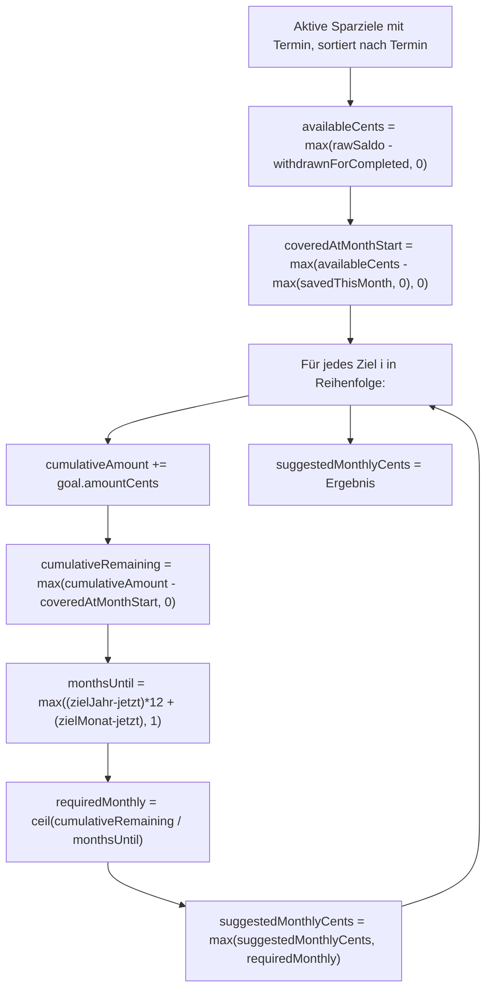

# Sparpläne und Sparziele

**Quelle:** `apps/web/app/api/saving-plan/route.ts`, `apps/web/app/api/saving-plan/[id]/route.ts`, `apps/web/app/api/saving-plan/[id]/complete/route.ts`, `apps/web/app/api/saving-plan/withdraw/route.ts`, `apps/web/app/api/saving-plan/compute.ts` (Berechnung), `apps/web/app/api/saving-plan/savings.ts` (Spartopf)
**Endpoints:** `GET/POST /api/saving-plan`, `GET/PATCH/DELETE /api/saving-plan/[id]`, `POST/DELETE /api/saving-plan/[id]/complete`, `POST /api/saving-plan/withdraw`

Was eine Spar-Kategorie ist und dass der Haushalt der Mandant ist, steht in
[00-grundregeln.md](./00-grundregeln.md) §2 und §3. „Laufender Monat" ist der Berliner Kalendermonat
(§1).

## Datenmodell

Sparziele verwenden das **Budget-Modell** mit `categoryId = null`:

```
Budget (als Sparziel)
├── categoryId  = null       — unterscheidet Sparziel von Kategorie-Budget
├── title                    — Pflichtfeld (z.B. "Urlaub 2027")
├── month       = Zielmonat  — wann das Ziel erreicht sein soll (1-12); null = ohne Termin
├── year        = Zieljahr   — null = ohne Termin (Monat und Jahr nur gemeinsam)
├── amountCents              — Ziel-Betrag in Cents (mind. 1); null = noch kein Betrag
├── completedAt = null       — null = aktives Ziel, gesetzt = abgeschlossen
└── spentCents  = null       — beim Abschluss tatsächlich aus dem Spar-Topf
                                entnommener Betrag (Snapshot); null solange aktiv
```

Drei Zustände, in der GET-Response getrennt geliefert:

| Liste | Bedingung | Rolle |
|---|---|---|
| `goals` | `completedAt == null`, Monat und Jahr gesetzt | aktive Ziele mit Termin — nur sie treiben Zielsumme und Monatsrate |
| `undatedGoals` | `completedAt == null`, ohne Termin | Ideen-Liste; nimmt an keiner Berechnung teil |
| `completedGoals` | `completedAt` gesetzt | abgeschlossen; `spentCents` reserviert einen Teil des Topfs |

Die Sparplan-Routen arbeiten nur mit `Budget`-Zeilen **ohne** Kategorie, gelesen über alle Konten des
Haushalts. Ein Kategorie-Budget ist hier kein Ziel: `GET` listet es nicht, die Routen unter `[id]`
und `[id]/complete` antworten dafür mit `404`.

## Verfügbares Spar-Guthaben (rawAvailableCents → availableCents)

### Schritt 1: Roher Spar-Saldo (rawAvailableCents)

`resolveSavingsBalanceCents(householdId)` in `savings.ts` ermittelt den Spartopf des Haushalts: die
negierte Summe aller Buchungen in **allen Spar-Kategorien** über **alle Konten**.

```typescript
const aggregate = await prisma.transaction.aggregate({
  where: {
    account: { householdId },
    categoryId: { in: [...savingsIds] },
    ...(range ? { occurredAt: { gte: range.start, lt: range.end } } : {})
  },
  _sum: { amountCents: true }
});
return 0 - (aggregate._sum.amountCents ?? 0);
```

**Wichtig:**
- Es werden **alle Sparbuchungen aller Zeiten** summiert, nicht nur diesen Monat (kein `range`)
- Einzahlungen sind negativ gespeichert, Entnahmen positiv — die negierte Summe ist der Saldo des Topfs
- Gelöschte Buchungen zählen nicht
- Ein Haushalt mit "Savings" und "Sparen" hat **einen** Topf aus beiden; jede Route sieht dieselbe Zahl
- Wenn keine Spar-Kategorie existiert: `rawAvailableCents = 0`

Dieser Wert wird in den Totals als `rawAvailableCents` ausgewiesen.

### Schritt 2: Reservierung für abgeschlossene Ziele (availableCents)

Der eigentliche Topf für die verbleibenden **aktiven** Ziele wird in der reinen Funktion
`computeSavingPlanTotals` (`compute.ts`) berechnet. Abgeschlossene Ziele reservieren
ihren bei Abschluss entnommenen Betrag (`spentCents`) aus dem rohen Saldo:

```typescript
const withdrawnForCompletedCents = goals
  .filter(isCompleted)                         // completedAt != null
  .reduce((sum, goal) => sum + (goal.spentCents ?? 0), 0);

const availableCents = Math.max(rawSavingsBalance - withdrawnForCompletedCents, 0);
```

**Wichtig:**
- `withdrawnForCompletedCents` = Summe `spentCents` **aller abgeschlossenen Ziele**
- `availableCents` = `max(rawAvailableCents − withdrawnForCompletedCents, 0)` — der bei 0
  geklammerte Topf, der den **aktiven** Zielen zur Verfügung steht
- Der Abschluss eines Ziels reduziert nur diesen rechnerischen Topf — siehe Abschnitt
  "Completion-Lebenszyklus" zur Buchungs-Konvention

`getAvailableSavingsCents(householdId)` in `savings.ts` berechnet denselben Wert für die Entnahme
(Obergrenze von `POST /api/saving-plan/withdraw`).

## Transaktionen verknüpft mit Sparzielen

```typescript
transactionSpentCents: goal.transactions.reduce((sum, tx) => sum + Math.abs(tx.amountCents), 0)
```

- `goal.transactions` = alle **nicht gelöschten** Transaktionen mit `savingGoalId = goal.id`
- Summiert den **absoluten Betrag** aller verknüpften Transaktionen
- Die Oberfläche zeigt den Wert als für das Ziel **ausgegeben** an. In die Berechnung des Topfs und
  der Monatsrate geht er nicht ein.

## Zielsumme (totalTargetCents)

```typescript
const totalTargetCents = activeGoals.reduce((sum, goal) => sum + (goal.amountCents ?? 0), 0);
```

`activeGoals` sind die aktiven Ziele **mit Termin**. Abgeschlossene Ziele und Ziele ohne Termin
zählen nicht zur offenen Zielsumme; ein Ziel ohne Betrag zählt mit 0.

## Empfohlene monatliche Sparrate (suggestedMonthlyCents)

Der Algorithmus berechnet den **kleinsten konstanten Monatsbetrag** X, mit dem alle
aktiven Sparziele mit Termin pünktlich erreicht werden können. X ist der Betrag, der in **jedem
verbleibenden Monat einschließlich des laufenden** zurückzulegen ist.

Deshalb wird gegen den Topf gerechnet, **wie er zu Beginn des laufenden Monats stand**: Was in diesem
Monat schon eingezahlt wurde, ist der Nutzer, der der Rate folgt — kein Grund, sie zu senken. (Würde
man die Einzahlungen dieses Monats als gedeckt zählen und den laufenden Monat trotzdem als offen,
zählte der Monat doppelt, und die Rate fiele, sobald man spart.)

### Algorithmus

```
savedThisMonth = Netto-Einzahlungen in die Spar-Kategorien im laufenden Monat
                 (resolveSavedThisMonthCents; Entnahmen abgezogen, kann negativ sein)
coveredAtMonthStart = max(availableCents - max(savedThisMonth, 0), 0)

Für jedes aktive Ziel i mit Termin (sortiert nach Jahr, Monat):
  cumulativeAmount[i] = Summe der Zielbeträge von Ziel 1 bis i
  cumulativeRemaining[i] = max(cumulativeAmount[i] - coveredAtMonthStart, 0)
  monthsUntil[i] = max((year - currentYear)*12 + (month - currentMonth), 1)
  requiredMonthly[i] = ceil(cumulativeRemaining[i] / monthsUntil[i])

suggestedMonthlyCents = max(requiredMonthly[1..n])     (ohne Ziele: 0)
```

Eine Netto-Entnahme im laufenden Monat (`savedThisMonth < 0`) wird nicht zurückaddiert — dieses Geld
ist aus dem Topf.



### Beispiel

**Annahmen:**
- Aktuell: Juni 2026
- Keine abgeschlossenen Ziele → `availableCents == rawAvailableCents`
- Topf zu Monatsbeginn: 1.000 € (100.000 Cents), im Juni noch nichts eingezahlt
- Ziel 1: "Laptop" — 800 € bis September 2026 (3 Monate), aktiv
- Ziel 2: "Urlaub" — 1.500 € bis Dezember 2026 (6 Monate), aktiv

| Schritt | Wert |
|---|---|
| coveredAtMonthStart | max(100.000 - 0, 0) = 100.000 Cents |
| cumulativeAmount nach Ziel 1 | 80.000 Cents |
| cumulativeRemaining Ziel 1 | max(80.000 - 100.000, 0) = 0 (schon gedeckt) |
| requiredMonthly Ziel 1 | ceil(0 / 3) = 0 |
| cumulativeAmount nach Ziel 2 | 230.000 Cents |
| cumulativeRemaining Ziel 2 | max(230.000 - 100.000, 0) = 130.000 |
| requiredMonthly Ziel 2 | ceil(130.000 / 6) = 21.667 Cents = 216,67 € |
| **suggestedMonthlyCents** | **21.667 Cents ≈ 216,67 €** |

Zahlt der Nutzer im Juni 216,67 € ein, steigt `availableCents` auf 121.667 Cents;
`coveredAtMonthStart` bleibt `121.667 − 21.667 = 100.000`, und die Rate bleibt bei 21.667 Cents.

### Wichtige Details

- `monthsUntil` wird auf **mindestens 1** geclampt — Division durch 0 ausgeschlossen; ein Ziel, dessen Termin der laufende Monat ist oder schon vorbei ist, wird mit einem Monat gerechnet
- `Math.ceil()` — immer aufgerundet, kein Untersparen möglich
- Der gedeckte Betrag wird nicht pro Ziel erneut abgezogen: Er steht den Zielen in Terminreihenfolge einmalig als Puffer zur Verfügung.
- Alle anderen Werte der `totals` (`rawAvailableCents`, `availableCents`, `totalTargetCents`) rechnen gegen den echten, aktuellen Topf — nur die Rate gegen den Stand zu Monatsbeginn.

## API-Besonderheit: flexible Feldnamen

Die POST- und PATCH-Endpunkte akzeptieren mehrere Feldnamen für Monat/Jahr:

```typescript
// POST: targetMonth, month, dueMonth (und targetYear, year, dueYear)
targetMonth: json?.targetMonth ?? json?.month ?? json?.dueMonth

// PATCH: targetMonth, month — ein ausdrückliches null bleibt erhalten (entfernt den Termin)
targetMonth: json?.targetMonth !== undefined ? json.targetMonth : json?.month
```

Monat und Jahr müssen immer gemeinsam gesetzt oder gemeinsam weggelassen bzw. auf `null` gesetzt
werden, sonst `400`. Ein Titel nur aus Leerraum und ein Betrag über dem int4-Bereich sind ebenfalls
`400`.

## Titel

Der Titel ist beim Anlegen Pflicht und wird ohne Leerraum am Rand gespeichert. `normalizeTitle` in
`route.ts` ist nur noch ein Fallback für alte Zeilen mit leerem Titel: Sie zeigt dann `JJJJ-MM` des
Termins, bei Zielen ohne Termin einen leeren Text.

## GET /api/saving-plan — Response

```typescript
{
  goals: [                          // aktive Ziele MIT Termin, sortiert nach Termin
    {
      id: string,
      accountId: string,
      categoryId: null,
      categoryName: null,
      title: string,
      month: number,
      year: number,
      amountCents: number | null,
      transactionSpentCents: number,  // Abs-Summe verknüpfter, nicht gelöschter Transaktionen
      completedAt: null,              // bei aktiven Zielen immer null
      spentCents: null,               // bei aktiven Zielen immer null
      createdAt: DateTime
    }
  ],
  undatedGoals: [ /* aktive Ziele OHNE Termin, gleiche Felder, month und year null */ ],
  completedGoals: [                 // abgeschlossene Ziele (completedAt != null), gleiche Felder
    {
      // …
      completedAt: DateTime,          // Abschluss-Zeitpunkt
      spentCents: number              // bei Abschluss entnommener Betrag (Snapshot)
    }
  ],
  totals: {
    rawAvailableCents: number,          // roher Spar-Saldo (vor Reservierung)
    withdrawnForCompletedCents: number, // SUM spentCents aller abgeschlossenen Ziele
    availableCents: number,             // max(rawAvailableCents - withdrawnForCompleted, 0)
    totalTargetCents: number,           // Summe der Zielbeträge aktiver Ziele mit Termin
    suggestedMonthlyCents: number       // Empfohlene Monatsrate (siehe oben)
  }
}
```

`404`, wenn der Haushalt kein Konto hat.

## Entnahme — `POST /api/saving-plan/withdraw`

Bucht Geld aus dem Spartopf zurück ins Alltagsbudget: eine **positive** Buchung in einer
Spar-Kategorie des Haushalts. Die Auswertungen ordnen sie als Sparen ein (Grundregeln §2) — sie
verringert „Gespart" des Monats und ist keine Einnahme.

- **Body:** `{ amountCents, accountId?, description? }` — `amountCents` ganze Zahl > 0; `accountId`
  Standard: das älteste Konto des Haushalts; `description` Standard `"Savings withdrawal"`
- **Obergrenze:** `getAvailableSavingsCents` — der Topf des Haushalts abzüglich der Reservierungen
  abgeschlossener Ziele. Mehr geht nicht: `409` mit `availableCents`
- **Kategorie:** Bei mehreren Spar-Kategorien geht die Buchung in die älteste
  (`findSavingsBookingCategoryId`). Gibt es keine: `409`
- **Datum:** `occurredAt` ist der Zeitpunkt der Anfrage
- **Response `201`:** `{ id, amountCents, availableCents }` (`availableCents` = Rest nach der Entnahme)

## Completion-Lebenszyklus

Ein Sparziel durchläuft zwei Zustände: **aktiv** (`completedAt == null`) und
**abgeschlossen** (`completedAt` gesetzt). Der Übergang erfolgt über die dedizierte
Route `POST/DELETE /api/saving-plan/[id]/complete`.

### Abschließen — `POST /api/saving-plan/[id]/complete`

- **Body (Zod):** `{ spentCents: number }` — Integer `>= 0` (höchstens int4), der tatsächlich aus dem
  Spar-Topf entnommene Betrag
- **Wirkung:** `completedAt = now`, `spentCents = <Body>`
- **Guards:** Auth (`401` ohne Session), Existenz (`404` Goal not found — auch für ein
  Kategorie-Budget), Haushalt (`403` Forbidden), Validierung (`400` bei ungültigem Body)
- **Response:** `{ id, completedAt, spentCents }`

### Wiedereröffnen — `DELETE /api/saving-plan/[id]/complete`

- **Wirkung:** `completedAt = null`, `spentCents = null` — das Ziel ist wieder aktiv
- **Guards:** identisch (Auth, Existenz, Haushalt)
- **Response:** `{ id, completedAt, spentCents }`

### Buchungs-Konvention (wichtig)

Der Abschluss erzeugt **keine echte Transaktion**. Der `spentCents`-Abzug ist eine
reine Berechnung in der Sparplan-API:

- Der **rohe Spar-Saldo** (`rawAvailableCents`, abgeleitet aus den Transaktionen der
  Spar-Kategorien) bleibt durch den Abschluss **unverändert**.
- Lediglich `availableCents` (der Topf für die aktiven Ziele) sinkt rechnerisch um den
  reservierten `spentCents`-Betrag.
- Der **echte Kontostand** sinkt nur, wenn die Ausgabe **separat als Transaktion**
  gebucht wird — der Abschluss allein bewegt kein Geld.

### Bekannte Grenzen

Diese Punkte sind bewusst unverändert und offen:

- **Kein Abgleich mit den Buchungen:** Weil der Abschluss keine Buchung erzeugt, ist „Verfügbar"
  (`availableCents`) = roher Topf − Σ `spentCents`. Sobald ein Ziel abgeschlossen wurde, lässt sich
  diese Zahl nicht mehr aus den Sparbuchungen allein herleiten und stimmt mit ihrer Summe nicht
  überein.
- **Entnahme und Abschluss zählen doppelt:** Wer das Geld für ein Ziel erst über `withdraw` entnimmt
  (der rohe Topf sinkt) und das Ziel danach mit demselben Betrag als `spentCents` abschließt (die
  Reservierung steigt), zieht den Betrag zweimal vom verfügbaren Topf ab. Die Oberfläche schlägt
  beim Abschluss den dem Ziel zugeordneten Anteil des Topfs als Betrag vor.
- **`spentCents` ist nicht durch den Topf begrenzt:** Jeder Wert von 0 bis zum int4-Maximum wird
  angenommen. `availableCents` wird bei 0 abgeschnitten, eine Überziehung ist danach nicht mehr
  sichtbar.
- **Wiedereröffnen gibt die Reservierung frei:** `spentCents` wird gelöscht, `availableCents` steigt
  wieder um diesen Betrag — auch wenn das Geld tatsächlich ausgegeben wurde.

### Auswirkungen auf andere Endpunkte

- `GET /api/analytics/summary`: `plannedSavings` zählt nur Ziele mit
  `completedAt == null` — abgeschlossene Ziele sind keine geplante Ersparnis mehr.
  Zusätzlich liefert die Route `completedGoals` (im **laufenden** Monat abgeschlossene
  Ziele, je `{ title, target, spent, completedAt }`, Euro) und `completedGoalsSpent`
  für die Dashboard-Anzeige.
- `GET /api/analytics/monthly-review`: liefert `completedGoals[]` (im abgefragten Monat
  abgeschlossene Ziele, je `{ title, amountCents, spentCents }`) und die Summe
  `completedGoalsSpentCents`.

In beiden Fällen entscheidet der Berliner Monat von `completedAt` (Grundregeln §1).
