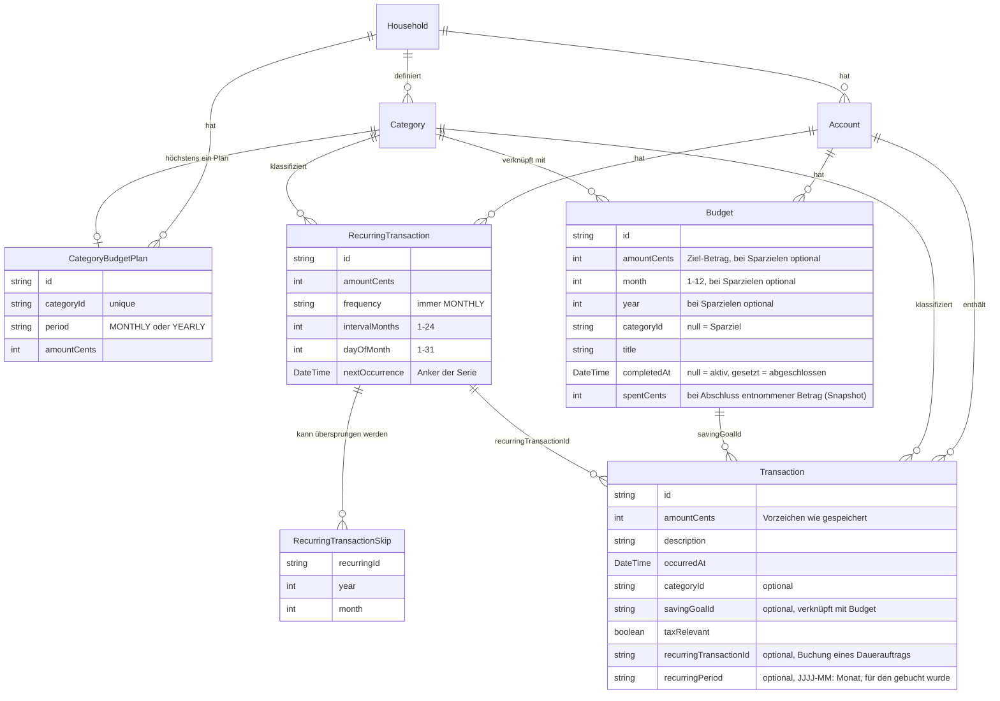

# Doewe — Berechnungsdokumentation

Diese Dokumentation beschreibt alle Berechnungslogiken und Datenflüsse der Doewe Finance-Plattform.
Sie dient sowohl als Referenz für Entwickler als auch als Wissensbasis für Claude-Tools.

Stand: 19. November 2026

## Inhalt

| Datei | Thema |
|---|---|
| [00-grundregeln.md](./00-grundregeln.md) | **Verbindliche Grundregeln:** Kalender (Europe/Berlin), Einordnung Einnahme / Ausgabe / Sparen, Umfang (Haushalt), gebucht vs. geplant, Abgleich zwischen den Bildschirmen |
| [01-geld-cents.md](./01-geld-cents.md) | Cents-System, Geldtypen, Parsing und Arithmetik |
| [02-transaktionen.md](./02-transaktionen.md) | Buchungen: Einordnung, Validierung, Buchungsliste |
| [03-wiederkehrende-transaktionen.md](./03-wiederkehrende-transaktionen.md) | Daueraufträge: Anker, Fälligkeit, automatisches Buchen, Skips |
| [04-analytics-summary.md](./04-analytics-summary.md) | Monatliche Zusammenfassung — alle Dashboard-Kennzahlen |
| [05-analytics-quarterly.md](./05-analytics-quarterly.md) | Quartalübersicht — letzte 3 Monate |
| [06-budgets.md](./06-budgets.md) | Budget-Pläne und Monats-Budgets vs. tatsächliche Ausgaben, Jahresübersicht nach Kategorien |
| [07-sparziele.md](./07-sparziele.md) | Sparziele, Spartopf, empfohlene Monatsrate, Entnahme, Abschluss-Lebenszyklus |

[00-grundregeln.md](./00-grundregeln.md) ist maßgeblich. Die Seiten 01–07 beschreiben einzelne
Bereiche und verweisen für Kalender, Einordnung und Umfang dorthin, statt die Regel zu wiederholen.
Widerspricht eine Seite den Grundregeln, gelten die Grundregeln und der Code.

Keine eigene Seite haben bisher:

- der **Monatsrückblick** (`GET /api/analytics/monthly-review`) — Felder und Semantik stehen im
  Kopfkommentar von `apps/web/app/api/analytics/monthly-review/route.ts` und in
  `docs/api-reference.md`; die Regeln, nach denen er rechnet, sind die Grundregeln.
- die **Jahresübersicht nach Kategorien** (`GET /api/analytics/category-year`) — beschrieben im
  Abschnitt „Jahresblick" von [06-budgets.md](./06-budgets.md).

## Kernprinzipien

Die Regeln selbst stehen in [00-grundregeln.md](./00-grundregeln.md); hier nur die Übersicht.

1. **Alle Beträge intern in Cents (Integer)** — niemals Floating-Point-Arithmetik für Geld (Grundregeln §5, [01-geld-cents.md](./01-geld-cents.md)).
2. **Ein Kalender: Europe/Berlin** — Tag, Monat und Jahr einer Buchung, „heute" und „aktueller Monat" sind auf Server und im Browser Berliner Kalenderwerte (Grundregeln §1, `packages/shared/src/calendar.ts`).
3. **Eine Einordnung** — zuerst die Spar-Kategorie, dann das Vorzeichen; `Category.isIncome` entscheidet nichts (Grundregeln §2, `packages/shared/src/cashflow.ts`).
4. **Mandant ist der Haushalt** — jede Auswertung umfasst alle Konten des Haushalts; gelöschte Buchungen zählen nirgends (Grundregeln §3).
5. **Daueraufträge werden automatisch gebucht, sobald sie fällig sind** — täglich durch den Cron `materialize-recurring`, für abgeschlossene Monate zusätzlich beim Lesen der Auswertungen. Ein Vorkommen ist `(recurringTransactionId, recurringPeriod)`. Nur ein im laufenden Monat fälliges, noch nicht gebuchtes Vorkommen zählt als „geplant", und nur im Dashboard (Grundregeln §4, [03-wiederkehrende-transaktionen.md](./03-wiederkehrende-transaktionen.md)).

Die ausführbare Fassung der Grundregeln sind `apps/web/tests/reconciliation.test.ts` (Abgleich der
Bildschirme untereinander, §6) und `apps/web/tests/recurring.occurrence.test.ts` (Vorkommen eines
Dauerauftrags, §1 und §4).

## Datenmodell-Übersicht

Quelle: `apps/web/prisma/schema.prisma`. Gezeigt sind nur die Felder, die für Berechnungen eine Rolle
spielen. `Account`, `Category`, `Transaction`, `RecurringTransaction`, `Budget` und
`CategoryBudgetPlan` tragen zusätzlich `deletedAt` (Soft-Delete).

